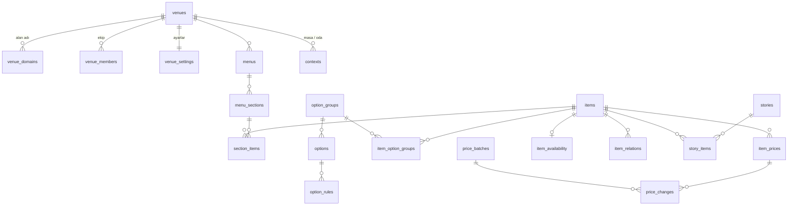

# Proje Planı — Kartela: Çok Mekânlı QR Menü Platformu

| Alan | Bilgi |
|---|---|
| Belge sürümü | v0.2 |
| Tarih | 2026-11-04 |
| Durum | Onaylandı (2026-11-04) · Kurulum (Faz 3) |
| Kapsam seviyesi | S4 ([§2](#2-kapsam-seviyesi)) |
| Hesap modeli | A — hesapsız ziyaretçi; çok rollü panel ([§8](#8-hesap-ve-yetki-modeli)) |
| Teknoloji varyantı | V1 + çok kiracılı sapmalar (ADR-0001…0005) ([§10](#10-teknoloji-ve-mimari-kararlar)) |
| Ortam | Demo (kurgusal içerik) |
| Yayın | `kartela-platform.vercel.app` (platform + panel; `kartela.vercel.app` başkasına ait, K-38), `rakim-kahve.vercel.app`, `kepce-lokanta.vercel.app` (ikisi de projeye bağlı, 2026-11-04) |
| Kaynak kod | GitHub, açık depo (portfolyo) |
| Sistem sürümü | web-proje 1.2.0 |

> **Güncel durum:** Plan 2026-11-04'te onaylandı (konsept A "Demleme Defteri", Q-01…Q-05 kapandı, K-19…K-31). Faz 3 kurulumu yapılıyor; ardından Faz 1 dilimleri (D-01…D-22). Faz 1 sonunda Rakım yayına çıkınca durulur, Faz 2 kullanıcı onayıyla başlar (K-29).

---

## İçindekiler
1. Proje özeti ve hedefler · 2. Kapsam seviyesi · 3. Hedef kitle ve roller · 4. Araştırma özeti ve varsayımlar · 5. Özellik listesi · 6. Site haritası ve ekranlar · 7. Kullanıcı akışları · 8. Hesap ve yetki modeli · 9. Veri modeli ve iş kuralları · 10. Teknoloji ve mimari kararlar · 11. Tasarım yönü · 12. Yönetim paneli · 13. CRM ve süreç yapısı · 14. Yasal ve içerik gereklilikleri · 15. SEO planı · 16. Güvenlik, performans, erişilebilirlik hedefleri · 17. Entegrasyonlar · 18. Test planı ve kalite kapıları · 19. Demo verisi ve canlıya geçiş · 20. Yayın ve operasyon · 21. Portfolyo planı · 22. Kapsam dışı, riskler, açık sorular · 23. İlerleme ve karar günlüğü

---

## 1. Proje özeti ve hedefler

**Tek cümle:** Kafe, restoran ve bar gibi mekânlara, her biri kendi alan adında ve kendi temasıyla bağımsız bir site gibi görünen, QR ile açılan hızlı ve anlatımlı dijital menüyü tek kod tabanından sunan platform.

**Vizyon:** Ziyaretçi masadaki QR'ı okutur; bir buçuk saniye içinde menüyü görür, alerjisine göre süzer, kahvesini özelleştirip ne ödeyeceğini görür, seçtiklerini garsona gösterir, merak ederse Keşfet'te ürünün hikâyesini okur. İşletme fiyatı ve müsaitliği telefondan tek dokunuşla değiştirir; kapı önü listesi ve basılı menü aynı veriden çıkar. Platform yeni bir mekânı hazır temayla bir iş gününde yayına alır. Asıl çıktı **altyapıdır**: tema sözleşmesi, menü motoru, kiracı yalıtımı ve `pnpm mekan:yeni`.

| Hedef | Ölçüt | Hedef değer |
|---|---|---|
| Yeni mekân (hazır tema) | Sıfırdan yayına süre (deneme mekânında ölçülür) | ≤ 1 iş günü (8 saat; onay beklemesi hariç) |
| Yeni mekân (özel tema) | Sıfırdan yayına süre | 3–5 iş günü |
| Hız | QR'dan sonra ilk ürün adı + fiyatı (Lighthouse mobil, yavaş 4G benzetimi) | FCP ≤ 1,5 sn ve ilk ürün FCP'de görünür |
| Kalite | Lighthouse mobil, menü sayfaları (her mekân) | Performans ≥ 95, Erişilebilirlik ≥ 95, En iyi uygulamalar ≥ 95, SEO denetimleri tek tek (demo `noindex`) |
| Yalıtım | Mekânlar arası veri sızıntısı | Kiracı test takımında 0 sızıntı; her kiracı tablosu kapsanır |
| Paket | Mekân rotası başına uygulama JS payı (gzip) | ≤ 50 KB; başka temanın modülü 0 bayt |
| Dayanıklılık | Son açılan menü çevrimdışı | Uçak kipinde açılır, "son güncelleme" notuyla |

## 2. Kapsam seviyesi

| Kilit sinyal | Var mı | Kanıt |
|---|---|---|
| Çok kiracılı yapı (her müşterinin verisi ayrık) | Evet | Brif: "Her sorgu yalnızca kendi mekânının verisini görür"; alan adına göre kiracı |
| Filtreli, aranabilir katalog ≥ 20 kayıt | Evet | Mekân başına 40–60 ürün, diyet / alerjen / acılık / fiyat filtresi, anlık arama |
| Birden fazla personel rolü | Evet | Platform yöneticisi, sahip, yönetici, personel |
| Etkileşimli araçlardan ≥ 3 | Evet | Ürün kurucu, filtre, arama, Seçtiklerim, toplu fiyat |
| Online ödeme / sipariş | Hayır | Sabit karar: sipariş ve ödeme yok (P2'ye açık veri modeli) |

**Seviye:** S4 · **Gerekçe:** Çok kiracılı yapı S4'ün kilit sinyalidir; kiracı yalıtımı testleri, ADR zorunluluğu ve yönetici 2FA bu seviyeden gelir. · **Zaman kutusu:** ~18 odaklı gün, fazlara bölünmüş (Faz 3 kurulum 1 gün; Faz 1 ≈ 8 gün; Faz 2 ≈ 7 gün; kalite + yayın + portfolyo 2 gün) · **Efor bütçesi:** faz başına ≤ 70 puan → Faz 1: 66 puan, Faz 2: 57 puan (§5).

## 3. Hedef kitle ve kullanıcı rolleri

| Rol | Kim | Ne yapar | Başlıca cihaz |
|---|---|---|---|
| Ziyaretçi | Masadaki misafir; yerli ve yabancı | QR okutur, menüyü süzer, ürün kurar, Seçtiklerim'i garsona gösterir, Keşfet'i okur | Telefon, tek el, çoğu zaman loş ortam |
| Personel | Barista, garson, mutfak | Tükendi, günlük adet, fırından çıkış, günün menüsü | Telefon (vardiya sırasında) |
| Yönetici | Mekân müdürü | Ürün, kategori, seçenek, fiyat, hikâye, görsel, çeviri, QR ve baskılar, içe aktarma, istatistik | Masaüstü + telefon |
| Sahip | İşletme sahibi | Yöneticinin yaptıkları + mekân ayarları, ekip, toplu fiyat onayı | Masaüstü |
| Platform yöneticisi | Geliştirici (Talha Keskin) | Mekân oluşturur, alan adı bağlar, tema ve kip seçer, kullanıcı davet eder | Masaüstü |

## 4. Araştırma özeti ve varsayımlar

Ayrıntı: [arastirma.md](arastirma.md)

**Öne çıkan bulgular:**
- **Servis / kuver ücreti yasak.** 30.01.2026 tarihli, 33153 sayılı RG değişikliğiyle lokanta, kafe, restoran ve benzeri işletmeler servis, masa, kuver ya da benzeri adla ilave ücret alamaz ve menüde bu ücretlere yer veremez. Brifteki "servis ücreti gösterilir" maddesi bu yüzden "alınmaz notu + engelleme" olarak uyarlandı (K-11, Q-01).
- **Karekod menü yasal ama yetmez.** 11.10.2025 değişikliği (RG 33044): masada karekodlu liste yeterli; istenirse fiziki liste verilir; her giriş kapısında liste; bütün ürünler listede; Bakanlık sistemine fiyat aktarımı (usul ve esaslar henüz ilan edilmedi).
- **Bileşen ve kalori zorunlu oluyor.** 2026 kılavuz revizyonu: toplu tüketimde bileşen 31.12.2026, enerji 31.12.2027'ye kadar zorunlu (zincirler 01.07.2026). Brif "isteğe bağlı" diyordu; alanlar birinci sınıf oldu (K-12, Q-04).
- **Vercel Hobby görsel kotası hesap başınadır**, proje başına değil; mekân başına ayrı proje kotayı artırmaz. Proje başına 50 alan adı. Ticari kullanım yasak.
- **Rakiplerin hepsi tek şablon.** Fark: mekâna özgü tema, Keşfet anlatımı, canlı fiyatlı ürün kurucu, mevzuat baskıları, çevrimdışı açılış.
- **Görsel bulunabilirliği:** açık / gün ışıklı kahve serisi kolay bulunuyor (10 adayın 7'si tutarlı); koyu seride logo ve zemin dağınıklığı var.

**Varsayımlar:**

| No | Varsayım | Neden | Değişirse etkisi |
|---|---|---|---|
| VR-01 | Platform adı "Kartela" (çalışma adı) | Brifte yok; portfolyo anlatısı için ad gerekli | Yalnızca `platform_settings` ve tanıtım sayfası |
| VR-02 | Kahveci: "Rakım Kahve Kavurma", Moda / Kadıköy; TR + EN | Kurgusal; ad İstanbul'da çakışmıyor (arandı) | `content/mekanlar/rakim/` |
| VR-03 | Deneme mekânı: "Kepçe Esnaf Lokantası", Sirkeci; TR + EN + AR | Kahveciden yapısal olarak farklı (günün menüsü, yarım porsiyon, RTL); hazır temayı en çok zorlayan tür | Q-02; tür değişirse yalnızca D-39'un içeriği |
| VR-04 | Alan adları `*.vercel.app` | Demo; özel alan adı brifte yok | Q-05; özel alan adı eklemek panelden |
| VR-05 | Fiyatlar 2026 İstanbul üçüncü dalga aralığında (filtre 220–260 ₺, latte 240–290 ₺) | Gerçekçi demo | Tohum verisi |
| VR-06 | İşletme telefonu ve WhatsApp: geliştiricinin hattı `0542 311 58 88` | Sistem kuralı (IC-01) | — |
| VR-07 | Stok görsel Unsplash (gerekirse Pexels), CDN'den | Vercel kotası; seri tutarlılığı | Görsel kaydı |

## 5. Özellik listesi

**Zorunlu paketler (K4):**
- **Çekirdek** (katalog/01-cekirdek) uyarlanarak: Z-08 Hakkımızda → Keşfet; Z-09 İletişim → `/bilgi` (adres, saatler, harita bağlantısı, tıkla-ara; form yok); Z-10 SSS → `/bilgi` altında 4–6 soru; Z-14 mobil eylem çubuğu → menü alt çubuğu (Ara · Filtre · Seçtiklerim · Bilgi); Z-30 site ayarları → mekân ayarları (`venue_settings`) + `platform_settings`; Z-31 içerik → hikâyeler. **Uygulanmaz:** Z-13 teşekkür ekranı, Z-15 iletişim formu, Z-29 talep kutusu, Z-05 onay kayıtları (ziyaretçi formu ve kişisel veri yok; K-15).
- **Yerel işletme:** mekân başına `CafeOrCoffeeShop` / `Restaurant` JSON-LD + `hasMenu`.
- **≥ 2 dil:** alan bazında çeviri, `hreflang`, dil seçici, RTL.
- **Birden fazla personel:** rol / yetki matrisi, işlem geçmişi.
- **Katalog ≥ 20 kayıt:** adres çubuğuyla eşli filtre, boş sonuç durumu.
- **Dosya yükleme (panel medya):** magic byte ve boyut denetimi, `sharp` ile yeniden kodlama.
- **Demo:** `DEMO_MODE` yerine mekân kaydında `mode: demo | live` (K-06).

| Kod | Özellik | Etiket | D | İ | B | Y | G | Puan | Efor | Öncelik | Dilim | REQ |
|---|---|---|---|---|---|---|---|---|---|---|---|---|
| QR-01 | Alan adına göre kiracı yönlendirme (üretim / yerel / önizleme / bilinmeyen) + tema rota iskeleti | X | 1 | 1 | 0 | 0 | 1 | 3 | M | P0 | D-01 | REQ-001 |
| QR-02 | Kiracı yalıtımı: kapsamlı erişim + bileşik FK + RLS + test takımı | X | 1 | 0 | 0 | 1 | 1 | 3 | M | P0 | D-02 | REQ-002 |
| QR-03 | Menüler ve zaman pencereleri (saat, gün, mevsim; gece yarısını aşan) | X | 1 | 1 | 1 | 0 | 1 | 4 | M | P0 | D-03, D-04 | REQ-003 |
| QR-04 | Fiyat türleri: tek, boy / varyant, yarım porsiyon, kg / 100 g, kadeh / şişe; KDV dahil | X-RST-01 | 1 | 1 | 1 | 1 | 1 | 5 | M | P0 | D-03 | REQ-004 |
| QR-05 | Ürün bilgisi: 14 alerjen, diyet, acılık, bileşen, enerji, gramaj, köken | X-RST-02 | 1 | 0 | 1 | 1 | 1 | 4 | S | P0 | D-03 | REQ-005 |
| QR-06 | Alan bazında çeviri, varsayılan dile düşme, RTL | X | 1 | 1 | 1 | 0 | 1 | 4 | M | P0 | D-03, D-10 | REQ-006 |
| QR-07 | Seçenek grupları, ürün kurucu, uyumluluk kuralları, canlı fiyat | X | 1 | 1 | 0 | 0 | 1 | 3 | M | P0 | D-05 | REQ-007 |
| QR-08 | Müsaitlik: tükendi, günlük adet, saatli çıkış, mevsim, günün menüsü | X-RST-01 | 1 | 1 | 1 | 0 | 1 | 4 | M | P0 | D-06, D-20 | REQ-008 |
| QR-09 | İlişkiler: eşleşme, öneri, set, sıralı tadım menüsü | X | 1 | 1 | 0 | 0 | 1 | 3 | M | P1 | D-06, D-25 | REQ-009 |
| QR-10 | Keşfet: ürün hikâyesi, şef notu, tedarikçi, bölümlü anlatım, zengin metin, galeri | X | 1 | 1 | 0 | 0 | 1 | 3 | M | P0 | D-07 | REQ-010 |
| QR-11 | Tema sözleşmesi + görünümsüz menü çekirdeği | X | 1 | 1 | 0 | 0 | 1 | 3 | M | P0 | D-08 | REQ-011 |
| QR-12 | Hızlı menü gezinme: yapışkan kategori, anlık arama, filtreler, alttan ürün paneli | X-RST-02 | 1 | 1 | 1 | 0 | 1 | 4 | M | P0 | D-09 | REQ-012 |
| QR-13 | Seçtiklerim (tarayıcıda) + "garsona göster" | X | 1 | 1 | 0 | 0 | 1 | 3 | S | P0 | D-08, D-10 | REQ-013 |
| QR-14 | Referans hazır tema "Sade" (3 hızlı + 2 Keşfet yerleşimi, RTL, koyu) | X | 1 | 1 | 0 | 0 | 1 | 3 | M | P0 | D-09, D-10 | REQ-014 |
| QR-15 | Mekân kabuğu: alan adı başına SEO, kip, yasal blok, bilgi, 404 | Z-16…19 | 1 | 0 | 1 | 1 | 1 | 4 | M | P0 | D-11 | REQ-015 |
| QR-16 | Statik üretim, etiketle yenileme, günlük cron, mekân başına bütçe ölçümü | X | 1 | 1 | 0 | 0 | 1 | 3 | M | P0 | D-12 | REQ-016 |
| QR-17 | Çevrimdışı açılış (mekân kapsamlı PWA) | X-RST-03 | 1 | 0 | 0 | 0 | 1 | 2 | M | P0 ¹ | D-13 | REQ-017 |
| QR-18 | Rakım özel teması | X | 1 | 1 | 0 | 0 | 1 | 3 | M | P0 | D-14, D-15 | REQ-018 |
| QR-19 | İmza: kahve özelleştirici (seçtikçe fiyat değişir) | X | 1 | 1 | 0 | 0 | 1 | 3 | M | P0 | D-16 | REQ-019 |
| QR-20 | İmza: saate göre menü + çekirdek kartları + demleme rehberi ve köken | X | 1 | 1 | 0 | 0 | 1 | 3 | M | P0 | D-17 | REQ-020 |
| QR-21 | Panel temeli (giriş, 2FA, roller, işlem geçmişi) + platform yöneticisi (mekân, alan adı, tema, kip) | A-01, A-02, A-03 | 1 | 1 | 1 | 0 | 1 | 4 | M | P0 | D-18, D-19 | REQ-021 |
| QR-22 | Panel müsaitlik: tek dokunuş tükendi, günlük adet, fırından çıkış, günün menüsü | A-17 türevi | 1 | 1 | 1 | 0 | 1 | 4 | M | P0 | D-20 | REQ-022 |
| QR-23 | `pnpm mekan:yeni` + `docs/yeni-mekan.md` + mekân test matrisi | X | 1 | 1 | 0 | 0 | 1 | 3 | M | P0 | D-21, D-22 | REQ-023 |
| QR-24 | Panel içerik yönetimi: menü, bölüm, ürün, seçenek ve kurallar | A-14 | 1 | 1 | 1 | 0 | 1 | 4 | M | P1 | D-23…D-26 | REQ-024 |
| QR-25 | Hikâyeler + medya kütüphanesi (yükleme, türevler, odak noktası) | A-13 | 1 | 1 | 0 | 0 | 1 | 3 | M | P1 | D-27, D-28 | REQ-025 |
| QR-26 | Çeviri yönetimi (eksik alanlar, dil ekle, RTL önizleme) | X | 1 | 1 | 0 | 0 | 1 | 3 | M | P1 | D-29 | REQ-026 |
| QR-27 | Toplu fiyat (yüzde / tutar, kategori, yuvarlama) + fiyat geçmişi + geri alma | X | 1 | 1 | 0 | 0 | 1 | 3 | M | P1 | D-30 | REQ-027 |
| QR-28 | Bağlamlar (masa, oda, şezlong, bölge) + QR üretici + temalı QR kartları | X-RST-03 | 1 | 1 | 1 | 0 | 1 | 4 | M | P1 | D-31 | REQ-028 |
| QR-29 | Kapı önü fiyat listesi + talep hâlinde verilecek basılı masa listesi (aynı veriden) | X-RST-17 | 1 | 1 | 0 | 1 | 1 | 4 | M | P0 | D-32 | REQ-029 |
| QR-30 | İçe aktarma: CSV / Excel, önizleme, satır hata raporu | A-15 | 1 | 1 | 0 | 0 | 1 | 3 | M | P1 | D-33 | REQ-030 |
| QR-31 | Çerezsiz istatistik: masa ve saate göre okutma, en çok bakılan ürün, dil, sonuçsuz arama | A-06, A-07 | 1 | 1 | 0 | 0 | 1 | 3 | M | P1 | D-34, D-35 | REQ-031 |
| QR-32 | Önizleme: kaydetmeden telefonda görünüm | X | 1 | 1 | 0 | 0 | 1 | 3 | M | P1 | D-36 | REQ-032 |
| QR-33 | Özel durumlar: şifreli gizli bölüm, bağlama göre menü / tema, saate göre tema değerleri | X | 1 | 0 | 0 | 0 | 1 | 2 | M | P1 | D-37 | REQ-033 |
| QR-34 | Platform tanıtım sayfası ("tek altyapı, N deneyim") + bilinmeyen alan adı | X | 1 | 1 | 0 | 0 | 1 | 3 | M | P1 | D-38 | REQ-034 |
| QR-35 | Deneme mekânı: hazır temayla sıfırdan yayına 1 iş günü (kabul testi) | X | 1 | 1 | 0 | 0 | 0 | 2 | L ² | P0 ³ | D-39 | REQ-035 |
| QR-36 | Bakanlık fiyat sistemine aktarım | X | 0 | 1 | 0 | 1 | 1 | 3 | M | P2 ⁴ | — | — |
| QR-37 | Garson çağır / masadan sipariş | X-RST "fark yaratan" | 1 | 1 | 1 | 0 | 0 | 3 | L | P2 | — | — |

¹ Brifin "Hız hedefleri" altında açıkça istenen madde; puanı düşük olsa da P0 (K-04). ² Zaman kutulu kabul testi; iki M parçası (D-39a, D-39b). ³ Brifin kabul ölçütü. ⁴ Y = 1 ama yükümlülük usul ve esasların ilanıyla doğar; ilan bulunamadı (2026-11-04). Veri modeli dışa aktarmaya hazır.

**Fark yaratan özellikler (bütçenin ~%20'si):** QR-19 canlı fiyatlı kahve özelleştirici (sipariş olmadan "ne ödeyeceğim" sorusunu cevaplar), QR-10 Keşfet (rakiplerde yok, kavurucu sitelerinin anlatımını masaya getirir), QR-13 "garsona göster" (dil bilmeyen misafir için büyük yazılı liste), QR-17 çevrimdışı açılış, QR-29 mevzuat baskılarının otomatik üretimi, QR-31 sonuçsuz arama raporu (menüde eksik olanı gösterir). Toplam ≈ 24 puan / 123.

**Efor özeti:** Faz 1: 22 dilim × M = **66 puan** (tamamı P0) · Faz 2: 16 dilim × M + D-39 (6) = **57 puan** (P0: D-32, D-39; diğerleri P1) · Toplam **123 puan**; S4 bütçesi faz başına ≤ 70 ✓. Faz 3 kurulum çekirdeği bütçe dışı (~8 puan, Levha kalibrasyonu).

### 5.1 Gereksinimler

| No | Gereksinim | Kabul kriterleri | Kurallar | Ekran |
|---|---|---|---|---|
| REQ-001 | Mekân alan adına göre çözülür | `rakim.localhost:3000` Rakım'ı, `kepce.localhost:3000` Kepçe'yi açar; `?mekan=rakim` önizlemede çerez yazar ve parametresiz adrese döner; `/m/rakim/` yol önekiyle açılır ve `noindex`; bilinmeyen alan adı 404; `/tema-rakim/...` dışarıdan 404 | BR-KRC-004 | SCR-001, SCR-051 |
| REQ-002 | Mekânlar arası sızıntı yok | Kiracı test takımı her kiracı tablosunda okuma / yazma / silme sızıntısını sınar; RLS'siz kiracı tablosu testi düşürür; başka mekânın kaydına eylem `notFound` | BR-KRC-001…003 | — |
| REQ-003 | Menüler zaman penceresine göre öne çıkar | 08:00–12:00 "Sabah" menüsü sabah ilk sırada; pencere dışı menü "12:00'de başlar" notuyla soluk; 22:00–02:00 penceresi gece yarısını doğru aşar; mevsim dışı ürün işaretli | BR-MNU-001, -002, BR-MST-004 | SCR-001 |
| REQ-004 | Fiyat türleri doğru gösterilir | Boy / varyant listesi, "Yarım · 140 ₺", "100 g · 240 ₺", "Kadeh / Şişe"; her fiyat `1.234,56 ₺` biçiminde; "Fiyatlara KDV dahildir" her dilde | BR-FYT-001, -002 | SCR-001, SCR-003 |
| REQ-005 | Ürün bilgisi eksiksiz | 14 alerjen sabit kümesi ve "eser miktarda içerebilir"; diyet; acılık 0–3; bileşen ve enerji ürün panelinde (enerji menü satırlarında **görünmez**, K-24); eksik bileşen / enerji panelde raporlanır; demo verisinde bütün ürünlerde dolu | BR-YSL-005 | SCR-003, SCR-106 |
| REQ-006 | Çeviri düşer, RTL döner | EN'de çevirisi olmayan açıklama TR gösterilir ve `lang="tr"` taşır; AR'de `dir="rtl"`, kategori çubuğu ve alt panel ters yönde, rakamlar okunur | BR-MNU-003 | Tümü |
| REQ-007 | Ürün kurucu kurallara uyar | Zorunlu grup seçilmeden "Seçtiklerime ekle" pasif ve nedeni yazılı; en çok sınırında ek seçim engellenir; uyumsuz seçenek nedeniyle pasif; fiyat her seçimde anında değişir | BR-SCN-001…003 | SCR-003 |
| REQ-008 | Müsaitlik görünür | Tükendi ürün sonda ve işaretli; günlük adet bitince tükendi; fırın ürününde "Sıradaki çıkış 15:00"; günün menüsü yalnızca bugünün ürünleri; tükendi 04:00'te düşer | BR-MST-001…005 | SCR-001 |
| REQ-009 | İlişkiler gösterilir | Ürün panelinde "Yanına" eşleşmeleri ve öneriler; set ürünü bileşenleriyle; tadım menüsü sıralı duraklarla | BR-ILS-001 | SCR-003, SCR-002 |
| REQ-010 | Keşfet akar | Aynı menünün blog gibi akan görünümü: büyük görsel, hikâye, şef notu, tedarikçi, duraklar; ürün kartına bağlı; galeri | — | SCR-002 |
| REQ-011 | Temalar sözleşmeye uyar | `satisfies ThemeModule` derlenir; konformans takımı (uç durum fikstürü) her temada geçer; tema başka temanın modülünü içe aktaramaz | BR-TMA-001, -002 | — |
| REQ-012 | Hızlı menü tek elle kullanılır | Kategori çubuğu yapışkan ve etkin bölümü izler; arama 50 ms içinde süzer (`tr-TR`: "ısırgan" ↔ "ISIRGAN"); filtreler adres çubuğunda; ürün detayı alttan panelde, geri tuşuyla kapanır; alt çubuk başparmak bölgesinde | — | SCR-001, SCR-003 |
| REQ-013 | Seçtiklerim garsona gösterilir | Ekle / çıkar / adet; özelleştirmeyle birlikte saklanır; tarayıcı kapanınca kalır, 24 saatte temizlenir; "Garsona göster" büyük yazılı tam ekran, TR karşılıklarıyla; "Bu bir sipariş değildir" notu | BR-SEC-001 | SCR-004 |
| REQ-014 | Sade hazır tema | Bütün yuvalar; hızlı menü liste / kart / ızgara; Keşfet akış / dergi; koyu mod; RTL; fotoğrafsız ürün görünümü; `/stil` | BR-TMA-002 | SCR-001…009 |
| REQ-015 | Mekân sitesi bağımsız | Her mekânın canonical'ı ve `metadataBase`'i kendi alan adı; kendi `robots.txt`, `sitemap.xml`, manifest, favicon, OG görseli, JSON-LD; mekânlar arası bağlantı yok; demo kipte `noindex` + şerit | BR-YSL-002 | SCR-001…008 |
| REQ-016 | Menü statik, değişiklik anında | Menü sayfaları derlemede üretilir; panelde tükendi → aynı mekânın sayfası sonraki istekte güncel, diğer mekânınki yenilenmez; mekân başına JS ölçümü CI'da | BR-KRC-005 | — |
| REQ-017 | Çevrimdışı açılış | Bir kez açılan menü uçak kipinde açılır; "Çevrimdışı · son güncelleme" notu; panel önbelleğe alınmaz; servis çalışanı kapsamı mekânın kökü | — | SCR-009 |
| REQ-018 | Rakım teması konsepte uyar | Plan §11 token'ları; GK maddeleri 1440 / 390'da işaretli; akşam token takımı 19:00'dan sonra ve koyu tercihte | — | SCR-001…008 |
| REQ-019 | Kahve özelleştirici | Boy, süt, shot, şurup (en çok 2), sıcaklık, kafeinsiz; fiyat rakamı seçimle kayar; tarif özeti ("Çift shot · yulaf · 12 oz") Seçtiklerim'e aynen gider | BR-SCN-001…003 | SCR-003 |
| REQ-020 | Saate göre menü ve çekirdekler | Sabah / gün / akşam menüsü saatle öne gelir, başlıkta etkin menü ve bitiş saati; çekirdek kartı köken, bölge, rakım, işleme, tadım notu, demleme önerisi, 250 g fiyatı; Keşfet'te demleme rehberi (V60, Chemex, AeroPress) ve köken hikâyeleri | BR-MNU-001 | SCR-001, SCR-002, SCR-003 |
| REQ-021 | Panel güvenli ve rollü | E-posta + parola; platform yöneticisi ve sahip için 2FA (canlı kipte zorunlu); rol matrisi (§8) testli; her yazma işlem geçmişinde; platform yöneticisi mekân oluşturur, alan adı bağlar, tema ve kip seçer | BR-YTK-001…003 | SCR-100…102, SCR-130…132 |
| REQ-022 | Personel telefondan tek dokunuş | Müsaitlik ekranı 360 px'te; ürün satırında tükendi anahtarı (44 px), günlük adet ±; işlem ≤ 1 sn içinde menüye yansır (etiket yenileme) | BR-MST-001…005 | SCR-108, SCR-109 |
| REQ-023 | Yeni mekân komutu | `pnpm mekan:yeni {ad} --tema {sade|yeni} --diller tr,en` tema ve içerik klasörünü, mekân ve alan adı kaydını, test listelerini, `/stil`'i üretir; `docs/yeni-mekan.md` Vercel alan adı adımlarını içerir; mekân matrisi (duman, ekran görüntüsü karşılaştırması, Lighthouse, görsel kalite) yeni mekânı kendiliğinden kapsar | — | — |
| REQ-024 | Panel içerik yönetimi | Menü (pencereler), bölüm (sürükle-bırak ve klavyeyle sıralama), ürün (fiyat türleri, bilgi, görsel, ilişkiler), seçenek grupları ve kurallar; eşzamanlı düzenlemede çakışma uyarısı | BR-SCN-*, BR-FYT-* | SCR-103…107 |
| REQ-025 | Hikâyeler ve medya | Markdown zengin metin + önizleme; galeri; medya yükleme (≤ 10 MB, JPEG / PNG / WebP / AVIF, magic byte), 640 / 960 / 1280 / 1920 / 2560 türevleri, odak noktası, alt metin (dil başına) | BR-MDY-001 | SCR-110, SCR-111 |
| REQ-026 | Çeviri yönetimi | Dil başına eksik alan listesi; satır içi düzenleme; dil eklemek / kaldırmak; AR için RTL önizleme | BR-MNU-003 | SCR-112 |
| REQ-027 | Toplu fiyat | Kategori seçimi, yüzde ya da tutar, yuvarlama kuralı; uygulamadan önce eski → yeni önizleme; tek işlemle uygula; geçmişte grup olarak görünür; geri alma (arada değişen satır atlanır ve raporlanır) | BR-FYT-003, -004 | SCR-113 |
| REQ-028 | Bağlam ve QR | Masa / oda / şezlong / bölge kodları; QR üretici (SVG); mekânın temasında yazdırılabilir A6 kartlar; bağlama göre menü ve token | BR-BGL-001 | SCR-114 |
| REQ-029 | Mevzuat baskıları | Kapı önü listesi (A4 / A3) ve masa listesi (A5) aynı veriden; yayındaki bütün ürünler (gizli bölüm dahil), KDV notu, alerjen ve enerji (masa listesinde), tarih; tarayıcıdan PDF | BR-YSL-003 | SCR-010, SCR-011 |
| REQ-030 | İçe aktarma | CSV / XLSX şablonu indirilir; yükleme → satır satır doğrulama (aynı Zod şeması) → önizleme → uygula; hatalı satırlar raporlanır, hiçbiri uygulanmaz ya da yalnızca geçerliler (seçimli) | BR-AKT-001 | SCR-115 |
| REQ-031 | Çerezsiz istatistik | Okutma (bağlam × saat), en çok açılan ürünler, dil dağılımı, sonuçsuz aramalar; çerez yok, IP saklanmaz; 10 haftalık tohum geçmişi | BR-IST-001 | SCR-116, SCR-102 |
| REQ-032 | Önizleme | Ürün düzenlerken kaydetmeden 390 px telefon çerçevesinde mekân temasıyla ürün kartı ve paneli | — | SCR-120 |
| REQ-033 | Özel durumlar | Şifreli bölüm (sunucuda doğrulama, hız sınırı, oturumluk); bağlama özgü menü ve token; gün dilimi token'ları (Rakım'da akşam) | BR-GZL-001, BR-BGL-001 | SCR-006 |
| REQ-034 | Platform tanıtımı | Platform alan adının kökünde vaka çalışması özeti, mekân vitrinleri (ekran görüntüsü), mimari şema | — | SCR-050 |
| REQ-035 | Deneme mekânı 1 günde | D-39 başlangıç ve bitiş zamanı kayıtlı; adım süreleri `docs/yeni-mekan.md` tablosuna yazılır; yayında, matris yeşil, görsel inceleme kapalı | — | — |

## 6. Site haritası ve ekran listesi

**Mekân sitesi** (her mekânın kendi alan adında; dil öneki: TR yok, diğerleri `/en`, `/ar` …):

| No | Ekran | URL | Şablon | Erişim | İndeks | Öncelik |
|---|---|---|---|---|---|---|
| SCR-001 | Hızlı menü | `/` | Menü | Herkes | Evet (canlı) | P0 |
| SCR-002 | Keşfet | `/kesfet` | Akış | Herkes | Evet | P0 |
| SCR-003 | Ürün detayı (alttan panel; doğrudan adresle tam sayfa) | `/urun/{urun}` | Detay | Herkes | Evet | P0 |
| SCR-004 | Seçtiklerim + garsona göster | panel (adres: `#sectiklerim`) | Katman | Herkes | — | P0 |
| SCR-005 | Bilgi (saatler, adres, harita bağlantısı, Wi-Fi, SSS, yasal notlar) | `/bilgi` | Metin | Herkes | Evet | P0 |
| SCR-006 | Gizli bölüm kapısı | `/gizli/{bolum}` | Form | Herkes | Hayır | P1 |
| SCR-007 | Stil karosu | `/stil` | Karo | Demo / önizleme | Hayır | P0 |
| SCR-008 | 404 (mekân dilinde) | — | Hata | Herkes | Hayır | P0 |
| SCR-009 | Çevrimdışı | `/cevrimdisi` | Durum | Herkes | Hayır | P0 |
| SCR-010 | Kapı önü fiyat listesi (yazdırma) | `/yazdir/kapi` | Baskı | Herkes (bağlantısız) | Hayır | P0 |
| SCR-011 | Masa listesi (yazdırma) | `/yazdir/masa` | Baskı | Herkes (bağlantısız) | Hayır | P0 |
| SCR-012 | QR kartları (yazdırma) | `/yazdir/qr` | Baskı | Yönetici oturumu (platform alan adından imzalı bağlantı) | Hayır | P1 |

**Platform alan adı:**

| No | Ekran | URL | Şablon | Erişim | İndeks | Öncelik |
|---|---|---|---|---|---|---|
| SCR-050 | Platform tanıtımı / vaka çalışması | `/` | Vitrin | Herkes | Evet | P1 |
| SCR-051 | Bilinmeyen alan adı / mekân yok | — | Hata | Herkes | Hayır | P0 |
| SCR-100 | Panel giriş | `/panel/giris` | Form | Herkes | Hayır | P0 |
| SCR-101 | 2FA doğrulama | `/panel/giris/dogrula` | Form | Oturum | Hayır | P0 |
| SCR-102 | Mekân pano (bugün: tükenenler, okutma, sonuçsuz aramalar) + mekân seçici | `/panel/{mekan}` | Pano | Üye | Hayır | P0 |
| SCR-103 | Menüler ve zaman pencereleri | `/panel/{mekan}/menuler` | Liste + form | Yönetici | Hayır | P1 |
| SCR-104 | Bölümler (sıralama) | `/panel/{mekan}/menuler/{menu}` | Sıralı liste | Yönetici | Hayır | P1 |
| SCR-105 | Ürünler | `/panel/{mekan}/urunler` | Liste | Yönetici | Hayır | P1 |
| SCR-106 | Ürün düzenle (sekmeler: genel, fiyatlar, bilgi, seçenekler, ilişkiler, görsel, çeviri) | `/panel/{mekan}/urunler/{urun}` | Detay | Yönetici | Hayır | P1 |
| SCR-107 | Seçenek grupları ve kurallar | `/panel/{mekan}/secenekler` | Liste + detay | Yönetici | Hayır | P1 |
| SCR-108 | Müsaitlik (telefon öncelikli) | `/panel/{mekan}/musaitlik` | Hızlı liste | Personel | Hayır | P0 |
| SCR-109 | Günün menüsü | `/panel/{mekan}/gunun-menusu` | Tarih + seçim | Personel | Hayır | P0 |
| SCR-110 | Hikâyeler | `/panel/{mekan}/hikayeler` | Liste + düzenleyici | Yönetici | Hayır | P1 |
| SCR-111 | Medya | `/panel/{mekan}/medya` | Izgara | Yönetici | Hayır | P1 |
| SCR-112 | Çeviriler | `/panel/{mekan}/ceviriler` | Eksik listesi | Yönetici | Hayır | P1 |
| SCR-113 | Toplu fiyat + fiyat geçmişi | `/panel/{mekan}/fiyatlar` | Sihirbaz + liste | Yönetici | Hayır | P1 |
| SCR-114 | Bağlamlar, QR ve baskılar | `/panel/{mekan}/qr` | Liste + baskı | Yönetici | Hayır | P1 |
| SCR-115 | İçe aktarma | `/panel/{mekan}/ice-aktar` | Sihirbaz | Yönetici | Hayır | P1 |
| SCR-116 | İstatistik | `/panel/{mekan}/istatistik` | Rapor | Yönetici | Hayır | P1 |
| SCR-117 | Mekân ayarları (bilgi, saatler, diller, yasal notlar) | `/panel/{mekan}/ayarlar` | Form | Sahip | Hayır | P0 |
| SCR-118 | Ekip | `/panel/{mekan}/ekip` | Liste | Sahip | Hayır | P0 |
| SCR-119 | İşlem geçmişi | `/panel/{mekan}/gecmis` | Zaman çizelgesi | Sahip | Hayır | P0 |
| SCR-120 | Önizleme (telefon çerçevesi) | ürün düzenleme içinde | Katman | Yönetici | Hayır | P1 |
| SCR-130 | Platform: mekânlar | `/panel/platform/mekanlar` | Liste | Platform yön. | Hayır | P0 |
| SCR-131 | Platform: mekân oluştur / alan adı / tema / kip | `/panel/platform/mekanlar/{mekan}` | Form | Platform yön. | Hayır | P0 |
| SCR-132 | Platform: kullanıcılar | `/panel/platform/kullanicilar` | Liste | Platform yön. | Hayır | P0 |

**Sabit öğeler (mekân sitesi):** üst çubuk (mekân kelime işareti · etkin menü ve bitiş saati · dil · görünüm geçişi Hızlı / Keşfet), yapışkan kategori çubuğu, alt eylem çubuğu (Ara · Filtre · Seçtiklerim (n) · Bilgi), demo şeridi (yalnızca demo kip), alt bilgi (yasal notlar, demo notu, "Created by Talha Keskin").

**Ana sayfa kurgusu:** mekân sitesinin ana sayfası menünün kendisidir: [§11.5](#115-ekran-ekran-sahne-sahne).

## 7. Kullanıcı akışları

**UC-01 QR'dan menüye** · Aktör: Ziyaretçi · Kurallar: BR-BGL-001, BR-MNU-001
1. Masa 12'deki QR'ı okutur (`https://rakim-kahve.vercel.app/?b=M12`).
2. Statik menü CDN'den gelir; ön boyama betiği gün dilimini ve etkin menüyü işaretler.
3. İlk ekranda: "Masa 12 · Sabah menüsü 12:00'ye kadar", öne çıkan ürün (tam genişlik fotoğraf), ardından ürün satırları.
- Alternatif: kod bilinmiyor → bağlam yok sayılır, menü normal açılır. Çevrimdışı ve önceden açılmış → önbellekten, "Çevrimdışı" notuyla.
- Kabul: ilk ürün adı ve fiyatı FCP'de; LCP ≤ 2,0 sn (yavaş 4G benzetimi).

**UC-02 Kahveyi kur, garsona göster** · Aktör: Ziyaretçi · Kurallar: BR-SCN-001…003, BR-SEC-001
1. "Latte"ye dokunur; alttan panel açılır.
2. Boy 12 oz, yulaf sütü (+25 ₺), çift shot (+35 ₺) seçer; fiyat her seçimde kayarak güncellenir.
3. "Seçtiklerime ekle" → alt çubukta sayaç 1.
4. Seçtiklerim → "Garsona göster": büyük yazı, Türkçe karşılıklar, toplam (bilgi amaçlı).
- Alternatif: soğuk demlemeye sıcak süt → seçenek pasif, "Soğuk demlemeyle sıcak süt seçilemez".
- Kabul: tarif özeti ve fiyat Seçtiklerim'de aynen; sayfa yenilense de liste kalır.

**UC-03 Alerjiye göre süz ve ara** · Aktör: Ziyaretçi
1. Filtre → "Glüten içermesin", "Vegan" → menü süzülür, adres `?filtre=gluten-yok,vegan`.
2. Arama "yulaf" → eşleşen ürünler; sonuç yoksa boş durum ve "filtreleri temizle".
- Kabul: süzme ≤ 50 ms; sonuçsuz arama istatistiğe düşer (kişisel veri olmadan).

**UC-04 Keşfet'e geç** · Aktör: Ziyaretçi
1. Üst çubukta "Keşfet" → köken hikâyeleri ve demleme rehberi akışı; kartlardan ürüne geçiş.
2. Ertesi gün aynı QR → doğrudan Keşfet açılır (çerez + proxy, ek gidiş-dönüş yok).

**UC-05 Personel "tükendi" işaretler** · Aktör: Personel · Kurallar: BR-MST-001
1. Telefonda panel → Müsaitlik → "Panama Geisha" satırında anahtar.
2. Eylem → `updateTag("menu:rakim")` → işlem geçmişi.
3. Misafirin sonraki açılışında ürün tükendi.
- Kabul: Kepçe'nin önbelleği yenilenmez; 04:00'te işaret kendiliğinden düşer.

**UC-06 Toplu zam ve geri alma** · Aktör: Yönetici · Kurallar: BR-FYT-003, -004
1. Fiyatlar → "Espresso bazlı" + "Filtre" → %8, "5 ₺'ye yukarı yuvarla".
2. Önizleme: 18 satır eski → yeni; uygula.
3. Hata fark edilir → geçmişte grup → "Geri al"; arada elle değişen 1 satır atlanır ve raporlanır.

**UC-07 Yeni mekân** · Aktör: Platform yöneticisi
1. `pnpm mekan:yeni kepce --tema sade --diller tr,en,ar` → klasörler, kayıtlar, testler.
2. İçerik ve görsel; tema yapılandırması; `/stil` incelemesi.
3. Panel → Platform → Kepçe → alan adı `kepce-lokanta.vercel.app` → Vercel API + yeniden yayın → "yayında".
- Kabul: REQ-035 süresi.

**UC-08 Baskılar** · Aktör: Yönetici
1. QR ve baskılar → masa kartları (12 masa, A6, temalı) → yazdır.
2. Kapı önü listesi (A4) ve masa listesi (A5) → tarayıcıdan PDF.
- Kabul: listede yayındaki bütün ürünler, tarih, "Fiyatlara KDV dahildir", "Servis ücreti alınmaz".

## 8. Hesap ve yetki modeli

**Model:** A · **Gerekçe:** Ziyaretçi işlem yapmaz; Seçtiklerim tarayıcıda yeter (karar mantığı §4, araştırma §7). Masadan sipariş (P2) gelince B'ye geçilir.

| Konu | Karar |
|---|---|
| Ziyaretçi kimlik doğrulaması | Yok |
| Panel girişi | Better Auth, e-posta + parola (15 karakter, sızıntı denetimi), veritabanı oturumu; yalnızca platform alan adında (mekân alan adlarında çerez yok) |
| 2FA | Platform yöneticisi ve sahip için canlı kipte zorunlu (TOTP); demo hesapları muaf (`PLATFORM_DEMO`) |
| Davet | Sahip, mekâna e-postayla davet eder (demo'da demo kutusu) |
| Seçtiklerim / görünüm | Tarayıcıda (`localStorage` / çerez) |

| İşlem | Personel | Yönetici | Sahip | Platform yön. |
|---|---|---|---|---|
| Tükendi, günlük adet, fırından çıkış, günün menüsü | ✔ | ✔ | ✔ | ✔ |
| Menü, bölüm, ürün, seçenek, hikâye, medya, çeviri | — | ✔ | ✔ | ✔ |
| Fiyat düzenleme, toplu fiyat, geri alma | — | ✔ | ✔ | ✔ |
| Bağlam, QR, baskılar, içe aktarma | — | ✔ | ✔ | ✔ |
| İstatistik | — | ✔ | ✔ | ✔ |
| Mekân ayarları (bilgi, saatler, diller, yasal notlar) | — | — | ✔ | ✔ |
| Ekip (davet, rol, çıkarma), işlem geçmişi | — | — | ✔ | ✔ |
| Mekân oluşturma, alan adı, tema, kip | — | — | — | ✔ |

## 9. Veri modeli ve iş kuralları

**Modül kısaltmaları:** `KRC` kiracı · `MNU` menü · `FYT` fiyat · `SCN` seçenek · `MST` müsaitlik · `ILS` ilişki · `SEC` Seçtiklerim · `YSL` yasal · `TMA` tema · `YTK` yetki · `BGL` bağlam · `GZL` gizli bölüm · `MDY` medya · `AKT` içe aktarma · `IST` istatistik.

**Kurallar:** Her kiracı tablosunda `venue_id uuid not null`; birincil anahtar UUIDv7; ilişkiler `(venue_id, id)` bileşik yabancı anahtarla; RLS açık ([ADR-0004](adr/0004-kiraci-yalitimi.md)). Çevrilebilir alanlar `jsonb` (`{ "tr": "…", "en": "…" }`, `tr` zorunlu). Para `*_minor integer` (kuruş). Zaman UTC.

| Tablo | Amaç | Önemli alanlar |
|---|---|---|
| `platform_settings` | Platform adı, tanıtım metinleri (tek satır) | `name`, `seo`, `version` |
| `users`, `sessions`, `accounts`, `verifications`, `two_factors` | Better Auth | `platform_role` (`admin` / null) |
| `venues` | Mekân kaydı | `slug`, `name`, `kind` (kafe, restoran, bar, otel…), `mode` (`demo` / `live`), `theme_id`, `theme_config jsonb`, `default_locale`, `locales[]`, `timezone`, `status` |
| `venue_domains` | Alan adları | `host` (benzersiz), `is_primary`, `status` (bekliyor / yayında / hata), `verified_at` |
| `venue_members` | Mekân üyelikleri | `user_id`, `role` (`owner` / `manager` / `staff`) |
| `venue_settings` | Mekân bilgileri (1:1, sürümlü) | `company`, `contact`, `hours`, `social`, `seo`, `legal` (`allergenStatement`, `extraCharges[]`, `alcoholPairings`), `features` (`waiterCall`, `ordering`: P2 anahtarları) |
| `menus` | Menü (kahvaltı, gün boyu, akşam, günün menüsü, tadım, gizli) | `slug`, `name`, `kind`, `schedule jsonb` (gün, saat pencereleri, tarih / mevsim aralığı), `outside_window` (`dim` / `hide`), `access` (`public` / `password` + `password_hash`), `contexts[]`, `sort` |
| `menu_sections` | Bölüm / kategori (iç içe en çok 2) | `menu_id`, `parent_id`, `name`, `description`, `layout_hint`, `sort` |
| `section_items` | Bölüm ↔ ürün (bir ürün birden çok bölümde) | `section_id`, `item_id`, `sort`, `featured` |
| `items` | Ürün | `slug`, `kind` (`dish` / `drink` / `bean` / `set` / `tasting`), `name`, `description`, `ingredients`, `allergens[]`, `may_contain[]`, `diets[]`, `spice_level` 0–3, `energy_kcal`, `nutrition jsonb`, `portion_g`, `volume_ml`, `origin`, `attributes jsonb` (türe göre Zod: çekirdek için köken, bölge, rakım, işleme, tadım notları, kavurma, demleme), `alcohol` (`brand`, `abv`), `image_id`, `status`, `version` |
| `item_prices` | Fiyat satırları | `item_id`, `label`, `unit` (`portion` / `half` / `per_100g` / `per_kg` / `glass` / `bottle` / `piece` / `size`), `amount_minor`, `is_default`, `sort` |
| `option_groups`, `options` | Seçenek grupları | `name`, `min_select`, `max_select`, `required`; seçenekte `price_delta_minor`, `allergens[]`, `diets_removed[]`, `is_default`, `available` |
| `item_option_groups` | Ürün ↔ grup | `item_id`, `group_id`, `sort`, `min_override`, `max_override`, `applies_to_price_ids[]` |
| `option_rules` | Uyumluluk | `item_id?`, `when_option_id`, `effect` (`excludes` / `requires`), `target_option_id` / `target_group_id`, `message` |
| `item_availability` | Müsaitlik | `item_id`, `sold_out_until`, `daily_limit`, `remaining`, `remaining_on date`, `release_times time[]`, `season jsonb` (ay aralıkları), `days[]` |
| `daily_menu_entries` | Günün menüsü | `menu_id`, `on_date`, `item_id`, `sort` |
| `item_relations` | Eşleşme / öneri | `from_item_id`, `to_item_id`, `kind` (`pairing` / `suggestion`), `note` |
| `set_components`, `tasting_courses` | Set ve sıralı tadım | set: `component_item_id`, `qty`; tadım: `course_no`, `title`, `item_id?`, `description` |
| `stories`, `story_items` | Keşfet | `kind` (`item_story` / `chef_note` / `supplier` / `chapter` / `guide`), `collection`, `chapter_no`, `title`, `body_md`, `cover_id`, `gallery_ids[]`; ürün bağları |
| `media_assets` | Görsel kaydı | `source` (`unsplash` / `pexels` / `upload`), `url`, `width`, `height`, `photographer`, `source_page`, `license`, `alt`, `focal_x`, `focal_y`, `dominant_color`, `variants jsonb` |
| `contexts` | Bağlam | `code` (QR'daki kısa kod), `kind` (`table` / `room` / `sunbed` / `zone`), `label`, `zone`, `menu_ids[]`, `token_variant` |
| `price_batches`, `price_changes` | Toplu fiyat ve geçmiş | grup: `rule jsonb`, `applied_by`, `applied_at`, `reverted_at`; satır: `item_price_id`, `old_minor`, `new_minor` |
| `import_jobs` | İçe aktarma | `file_name`, `rows jsonb` (doğrulama sonucu), `status`, `applied_at` |
| `stat_scans_hourly`, `stat_item_views_daily`, `stat_locales_daily`, `stat_search_misses_daily` | Çerezsiz sayaçlar | yalnızca toplamlar: (`venue_id`, tarih, saat, `context_code`, `count`) vb. |
| `audit_logs`, `action_rate_limits`, `demo_outbox` | İskelet tabloları (mekân kolonlu) | `venue_id?` |

| No | Kural | Tür | Test |
|---|---|---|---|
| BR-KRC-001 | Kiracı tablosundaki satır yalnızca kendi mekânı kapsamında görünür (RLS) | Kısıt | `tenant/rls.test.ts` (tablo listesi şemadan) |
| BR-KRC-002 | İlişki yalnızca aynı mekân içinde kurulabilir (bileşik FK) | Kısıt | `tenant/cross-venue-fk.test.ts` |
| BR-KRC-003 | Panel kullanıcısı yalnızca üyesi olduğu mekâna erişir; başka mekânın kaydı `notFound` | Yetki | her eylem için `*.authz.test.ts` |
| BR-KRC-004 | Bilinmeyen alan adı 404; `/tema-*` iç yolları dışarıdan 404 | Kısıt | `proxy.test.ts`, e2e |
| BR-KRC-005 | Önbellek etiketi mekân önekli; bir mekânın güncellemesi diğerinin sayfasını yenilemez | Kısıt | `tenant/cache-tags.test.ts` |
| BR-MNU-001 | Menü penceresi `Europe/Istanbul` saatine göre; gece yarısını aşan pencere desteklenir | Hesaplama | `domain/schedule.test.ts` (it.each; 23:59, 00:00, DST yok) |
| BR-MNU-002 | Pencere dışı menü `dim` ise soluk + "HH:MM'de başlar", `hide` ise gizli | Varsayılan | `schedule.test.ts` |
| BR-MNU-003 | Çevirisi olmayan alan varsayılan dile düşer ve `lang` ile işaretlenir | Hesaplama | `i18n/fallback.test.ts` |
| BR-FYT-001 | Tutar kuruş tamsayı; gösterim KDV dahil | Kısıt | `money.test.ts` |
| BR-FYT-002 | Birimli fiyat birimiyle yazılır ("100 g · 240 ₺"); kg ve 100 g aynı üründe birlikte olmaz | Kısıt | `price-format.test.ts` |
| BR-FYT-003 | Toplu güncelleme: yüzde ya da tutar, kategori kapsamı, yuvarlama (yukarı 1 / 5 / 10 ₺, "9 ile biter"); sonuç ≥ 0 | Hesaplama | `domain/bulk-price.test.ts` |
| BR-FYT-004 | Geri alma yalnızca hâlâ grubun yazdığı değerde olan satırlara uygulanır; diğerleri atlanır ve raporlanır | Kısıt | `bulk-price.integration.test.ts` |
| BR-SCN-001 | Zorunlu grupta en az `min`, her grupta en çok `max` seçim | Kısıt | `domain/configurator.test.ts` |
| BR-SCN-002 | Fiyat = seçilen fiyat satırı + seçenek farkları (negatif fark izinli; toplam ≥ 0) | Hesaplama | `configurator.test.ts` |
| BR-SCN-003 | Uyumluluk: "A seçiliyse B seçilemez / C gerekir"; ihlal eden seçenek pasif, nedeni gösterilir | Kısıt | `configurator.test.ts` |
| BR-MST-001 | Tükendi işareti `sold_out_until` (varsayılan bugün 04:00 sonrası) dolunca düşer; "süresiz" seçeneği var | Tetikleyici | `availability.test.ts` |
| BR-MST-002 | Günlük adet 0'a inince tükendi; ertesi gün `daily_limit`'e döner | Tetikleyici | `availability.test.ts` |
| BR-MST-003 | Saatli çıkışta sıradaki çıkış saati gösterilir; gün bittiyse "yarın 07:00" | Hesaplama | `availability.test.ts` |
| BR-MST-004 | Mevsim dışı ürün: `dim` ise "Mevsiminde: Eylül–Mart", `hide` ise gizli | Varsayılan | `availability.test.ts` |
| BR-MST-005 | Günün menüsü yalnızca o tarihin kayıtlarını gösterir; kayıt yoksa bölüm boş durumda | Kısıt | `daily-menu.test.ts` |
| BR-ILS-001 | İlişki kendine olamaz; aynı çift aynı türde tekrar edemez | Kısıt | `relations.test.ts` |
| BR-SEC-001 | Seçtiklerim mekân anahtarlı; 24 saatten eski liste temizlenir; ürün kaldırıldıysa "artık menüde yok" | Varsayılan | `picks.test.ts` |
| BR-YSL-001 | Yeme-içme mekânında `service` / `cover` / `table` türünde ek ücret tanımlanamaz; diğer ek ücret türleri tanımlanabilir. "Servis, masa ya da kuver ücreti alınmaz" notu yasal blokta, `/bilgi`'de ve basılı listelerde durur; menüye ayrı şerit olarak eklenmez (GK-16, K-21). Otel oda servisi o mekân açılırken ayrıca araştırılır (RG 33153) | Kısıt | `legal.test.ts` |
| BR-YSL-002 | Her menü sayfasında, her dilde: "Fiyatlara KDV dahildir", "Basılı fiyat listesini isteyebilirsiniz", alerjen beyanı | Kısıt | e2e `legal-notes.spec.ts` |
| BR-YSL-003 | Kapı önü ve masa listesi yayındaki bütün ürünleri içerir (gizli bölüm ve tükenenler dahil) | Kısıt | `print-list.test.ts` |
| BR-YSL-004 | Alkollü ürün: marka, hacim (cl), fiyat; 18 yaş notu; görsel ve eşleşme varsayılan kapalı (Q) | Varsayılan | `legal.test.ts` |
| BR-YSL-005 | Bileşen ve enerji eksik ürünler panelde raporlanır; yayında alan boşsa "bilgi için personele sorun" | Varsayılan | `completeness.test.ts` |
| BR-TMA-001 | Tema yalnızca kendi rota ağacında yüklenir; başka temanın modülü pakete girmez | Kısıt | ESLint sınırı + `bundle-isolation.spec.ts` |
| BR-TMA-002 | Tema konformans fikstüründen geçmeden mekâna bağlanamaz | Kısıt | `tests/tema/*` |
| BR-YTK-001 | Rol matrisi §8 | Yetki | `permissions.test.ts` + eylem testleri |
| BR-YTK-002 | Platform yöneticisi ve sahip için canlı kipte 2FA zorunlu | Yetki | `auth.integration.test.ts` |
| BR-YTK-003 | Son sahip mekândan çıkarılamaz | Kısıt | `members.test.ts` |
| BR-BGL-001 | Bağlam kodu yalnızca kayıtlıysa uygulanır; bilinmeyen kod yok sayılır | Kısıt | `context.test.ts` |
| BR-GZL-001 | Gizli bölüm şifresi sunucuda doğrulanır; 10 dk'da 5 deneme; içerik statik HTML'de yok | Yetki | `secret.integration.test.ts` + e2e HTML denetimi |
| BR-MDY-001 | Yükleme: ≤ 10 MB, JPEG / PNG / WebP / AVIF (magic byte), `sharp` ile yeniden kodlama, EXIF silme | Kısıt | `upload.test.ts` |
| BR-AKT-001 | İçe aktarma satırları içerik şemasıyla doğrulanır; hatalı satırla "tümü ya da hiçbiri" varsayılan | Kısıt | `import.test.ts` |
| BR-IST-001 | İstatistik kişisel veri tutmaz: çerez yok, IP saklanmaz (yalnızca hız sınırı için günlük tuzlu karma, bellekte) | Kısıt | `stats.test.ts` |

**Parametreler:**

| No | Parametre | Varsayılan | Nerede |
|---|---|---|---|
| P-01 | Gün sonu (tükendi düşme, günlük adet sıfırlama, cron) | 04:00 `Europe/Istanbul` | `config/limits.ts` |
| P-02 | Gizli bölüm deneme sınırı | 10 dk'da 5 | `config/limits.ts` |
| P-03 | Seçtiklerim saklama süresi | 24 saat | `config/limits.ts` |
| P-04 | İstatistik saklama | 13 ay (sonra aylık toplama) | `config/limits.ts` |
| P-05 | Servis çalışanı görsel önbelleği | 60 görsel / mekân | `sw.js` üretici |
| P-06 | Toplu fiyat varsayılan yuvarlama | 5 ₺'ye yukarı | `venue_settings` |
| P-07 | Arama en az karakter | 2 | `config/limits.ts` |
| P-08 | Medya yükleme sınırı | 10 MB | `config/limits.ts` |

## 10. Teknoloji ve mimari kararlar

**Varyant:** V1 · Yığın: [docs/standartlar/01-teknoloji-yigini.md](standartlar/01-teknoloji-yigini.md) · ADR'ler: [`docs/adr/`](adr/)

| ADR | Karar |
|---|---|
| [ADR-0001](adr/0001-tek-uygulama-alan-adina-gore-kiraci.md) | Tek Next.js uygulaması, tek Vercel projesi, alan adına göre kiracı (B: monorepo + mekân başına proje reddedildi) |
| [ADR-0002](adr/0002-kiraci-cozumleme-ve-alan-adi-haritasi.md) | `proxy.ts` çözümleme sırası; derleme anı alan adı haritası; görünüm hatırlama proxy'de |
| [ADR-0003](adr/0003-tema-sozlesmesi-ve-rota-alt-agaci.md) | Tema = rota alt ağacı + kök düzen; `ThemeModule` sözleşmesi; görünümsüz çekirdek |
| [ADR-0004](adr/0004-kiraci-yalitimi.md) | Kapsamlı erişim + bileşik FK + RLS; kiracı test takımı |
| [ADR-0005](adr/0005-statik-menu-istemcide-zaman-ve-baglam.md) | Statik menü; zaman, bağlam, kişisel durum istemcide; el yazımı servis çalışanı |

| Konu | Karar | Gerekçe |
|---|---|---|
| Klasör yapısı | `src/platform/` (çekirdek: `menu/`, `theme/`, `routes/`, `i18n/`, `tenant/`), `src/themes/{id}/`, `src/app/tema-{id}/[mekan]/[dil]/` (üretilir), `src/app/(platform)/` (tanıtım + panel), `content/mekanlar/{ad}/` (mekan.ts, menu.ts, hikayeler/*.md, gorseller.ts), `scripts/mekan/` | ADR-0003; içerik koddan ayrı |
| Cache Components | Açık | Menü statik, etiketle yenileme; panel dinamik |
| Çok dil | **next-intl yok** (K-08): içerik çevirisi veride (`jsonb`), arayüz metinleri `src/platform/i18n/{dil}.ts` tipli sözlük; istemci bileşenine metin prop olarak iner | Paket bütçesi; arayüz metni az, içerik veride |
| Hareket | Mekân sayfalarında Motion yok (K-09): CSS geçişleri + View Transitions API (alttan panel, görünüm geçişi); yalnızca `transform` / `opacity` | ≤ 50 KB uygulama payı |
| Görsel | Stok: Unsplash / Pexels CDN özel loader; yüklenen: Vercel Blob + yüklemede `sharp` türevleri (640…2560) | Vercel görsel kotası hesap başına; hiç kullanılmaz |
| Zengin metin | Markdown → `react-markdown` + `remark-gfm` yalnızca sunucu bileşeninde (ham HTML kapalı, `dangerouslySetInnerHTML` yok); panelde Markdown + önizleme (WYSIWYG yok) (K-34) | Sunucuda kalır, istemci paketi yok; temizleyici kütüphane gerekmez |
| QR | `qrcode` (SVG, sunucu) | Küçük, bağımlılıksız |
| PDF | Yazdırma CSS'li HTML sayfaları (A4 / A5 / A6); tarayıcıdan "PDF olarak kaydet" (K-10) | Sunucuda başsız tarayıcı Vercel'de yok; tema token'ları baskıda da geçerli |
| İçe aktarma | `papaparse` (CSV), `read-excel-file` (XLSX), yalnızca sunucu | Hafif; şemayla doğrulama |
| Grafik (istatistik) | El yazımı SVG çubuk / ısı haritası (dataviz yönergesi) | Grafik kütüphanesi panel bütçesini yer |
| Alan adı yönetimi | Vercel REST API (alan adı ekle / doğrula) + Deploy Hook; anahtar yoksa panel elle adım listesi gösterir | ADR-0002 |
| Zamanlanmış iş | Vercel Cron günde bir (04:00): etiket yenileme, günlük adet sıfırlama, istatistik toplama | Hobby: günde bir |
| Ortam bayrakları | `DEMO_MODE` yerine `venues.mode`; platform işlemleri için `PLATFORM_DEMO` (db:reset, demo panel girişi) (K-06) | Brif |
| Önbellek etiketleri | `menu:{mekan}`, `venue:{mekan}`, `stories:{mekan}`, `stats:{mekan}`, `platform` | ADR-0004 |
| CSP | Mekân sayfaları statik CSP (`script-src 'self' 'unsafe-inline'`); ön boyama betiği bu kapsamda, özet eklenmez (K-33); panel nonce'lu CSP | ADR-0005 |

## 11. Tasarım yönü

Bu bölüm önerilen konsepte (**A. Demleme Defteri**, Rakım) göre doldurulmuştur. Kullanıcı B'yi seçerse §11.1–11.7 B ile yeniden yazılır. Sade (hazır tema) ve panel §11.8'dedir. Deneme mekânının konsepti D-39a'da iki öneriyle sunulur.

### 11.1 Konsept

| Konu | Karar |
|---|---|
| Konsept adı | **Demleme Defteri** |
| Tanım | Zemin gün ışığı alan kırık beyaz kâğıt, metin grafit; ekran barda açık duran bir demleme defteri gibi okunur. Tek vurgu kavurma turuncusu yalnızca canlı fiyatta, etkin saatte ve seçili çipte; rakım, oran, sıcaklık ve gram tablo rakamlı monospace ile veri gibi dizilir. Fotoğraflar açık taş / beyaz zeminde yandan pencere ışığıyla, keskin gölgeli tepeden çekimler; hareket kısa ve ölçülü, fiyat değişince yalnızca rakam kayar. |
| Seçilmeyen alternatif | **Kehribar Gece** (koyu zemin, krem, kehribar; düşük anahtarlı fotoğraf). Seçilmedi: sektörün "dark moody kahve" stok görünümüne yakın; ilk taramada seri tutarsız (10 adayın 5'i logolu); gündüz çalışan bir kahvecide okunurluğu akşam kipine bırakmak daha doğru. Akşam kipi A'nın içinde token takımı olarak var. |
| Olmayacaklar | 1. Kara tahta, el yazısı font, ahşap doku, kraft kâğıt (sektör klişesi). 2. Kahve çekirdeği deseni, fincan ikonu dizisi, buhar süsü. 3. Kahverengi tek ton palet; ikinci vurgu rengi. 4. Her bölümü kart içine koymak; renk kodlu kategori. 5. "Dark moody" düşük anahtarlı stok fotoğrafı (seriye aykırı). 6. Degrade, cam efekti, parıltı. 7. Kalp latte art'ı birden fazla görselde. |
| Referans panosu | La Cabra (açık zeminde tek başına ürün fotoğrafı) · Onyx Coffee Lab (kahve başına veri satırları) · Coffee Collective (köken ↔ ürün bağı) · Tim Wendelboe (az renk, net hiyerarşi) · Kurasu Kyoto (adım adım demleme dizisi) · Blue Bottle (tek ışıklı seri) · Kronotrop (Türkçe terminoloji) · Caravan (köken / işleme / tadım veri satırı) |
| İmza öğesi | **Tarif kartı biçiminde kahve özelleştirici:** seçimler defter satırları gibi dizilir ("Shot · çift · +35 ₺"), altta monospace toplam rakamı kayarak değişir; özet satırı ("12 oz · yulaf · çift shot") Seçtiklerim'e aynen gider. İkincil imza: üst çubukta etkin menü ve bitiş saati ("Sabah · 12:00'ye kadar") ve çekirdek kartında rakım çizgisi (köken bölgesinin rakımı yatay ölçek üzerinde). |
| Metin tonu | Bilgili ama kibirsiz; kısa cümleler; teknik terim Türkçesiyle ("demleme", "oran 1:16", "yıkanmış işleme"); "siz" hitabı; abartı yok |

### 11.2 Renk

| Token | Kullanım | Değer | Kontrast (hesaplanan, D-14'te ölçülür) |
|---|---|---|---|
| `--background` | Kâğıt zemin | `#F3F1EC` | — |
| `--surface` | Ürün paneli, alt panel | `#FBFAF7` | — |
| `--surface-muted` | Bölüm başlığı bandı, çip zemini | `#E9E5DD` | — |
| `--foreground` | Gövde, ürün adı | `#1F1D1A` | 14,8:1 (kâğıtta) |
| `--muted-foreground` | Açıklama, birim, saat | `#5E5A54` | 6,1:1 |
| `--border` | İnce çizgi (defter satırı) | `#DAD5CC` | dekoratif |
| `--primary` / `--primary-foreground` | Birincil düğme (mürekkep) | `#1F1D1A` / `#F3F1EC` | 14,8:1 |
| `--accent` | Canlı fiyat, etkin saat, seçili çip (≤ %10) | `#B4441B` (kavurma turuncusu) | 4,9:1 (kâğıtta) |
| `--sold-out` | Tükendi etiketi ve üstü çizili fiyat | `#6B665E` + "Tükendi" metni | 5,05:1 |
| `--focus` | Odak halkası | `#1F1D1A` 2 px + 2 px kâğıt boşluk | ≥ 3:1 |

Kontrast değerleri WCAG göreli parlaklık formülüyle hesaplandı (2026-11-04); D-14'te `/stil` üzerinde axe ve kontrast testiyle doğrulanır. Vurgu `#B4441B`, `--surface-muted` üzerinde 4,42:1 kalır: seçili çip vurgu **zemin** + kâğıt metin (4,92:1) olarak çizilir, vurgu renkli metin bu zemine konmaz.

**Akşam takımı ("Gece defteri", K-19).** Açık temanın tersine çevrilmesi değildir; ayrı bir sahne olarak tasarlandı: bar lambasının altında açık duran defter. Zemin sıcak kâğıdın karşılığı olan soğuk bir gece mürekkebidir (grafit-lacivert). Metin lamba ışığı almış kâğıt rengindedir; vurgu, koyu zeminde ölçülerek seçilmiş açık bir köz turuncusudur. 19:00–06:00 arası (`daypart.aksam` / `gece`) ve `prefers-color-scheme: dark` tercihinde uygulanır.

| Token | Kullanım | Değer | Kontrast (hesaplanan) |
|---|---|---|---|
| `--background` | Gece mürekkebi zemin | `#161A1D` | — |
| `--surface` | Ürün paneli, alt panel | `#1E2327` | — |
| `--surface-muted` | Bölüm bandı, çip zemini | `#252B30` | — |
| `--foreground` | Gövde, ürün adı (lamba ışığında kâğıt) | `#ECE6DA` | 14,09:1 zemin · 12,75:1 yüzey · 11,52:1 soluk yüzey |
| `--muted-foreground` | Açıklama, birim, saat | `#B3AC9F` | 7,77:1 zemin · 7,03:1 yüzey · 6,35:1 soluk yüzey |
| `--border` | Defter satırı çizgisi | `#2C3236` | dekoratif |
| `--primary` / `--primary-foreground` | Birincil düğme | `#ECE6DA` / `#161A1D` | 14,09:1 |
| `--accent` | Köz turuncusu: canlı fiyat, etkin saat (≤ %10) | `#E8955F` | 7,42:1 zemin · 6,71:1 yüzey · 6,06:1 soluk yüzey |
| `--accent-foreground` | Vurgu zeminli çipte metin | `#161A1D` | 7,42:1 |
| `--sold-out` | Tükendi | `--muted-foreground` + "Tükendi" metni | 7,77:1 |
| `--focus` | Odak halkası | `#ECE6DA` 2 px | ≥ 3:1 |

Fotoğraflar akşam takımında değiştirilmez; yalnızca görsel kenarında 1 px `--border` çerçeve ve parlak beyaz zeminli görsellerde `filter` kullanılmaz (renk sadakati).

### 11.3 Tipografi

| Konu | Karar |
|---|---|
| Başlık / gövde | **Schibsted Grotesk** (değişken, 400–700, `latin` + `latin-ext`) · veri / fiyat: **IBM Plex Mono** 500 (`latin` + `latin-ext`, tablo rakamları). Toplam 4 dosya (bütçe ≤ 4). Türkçe karakter testi (ğ ş ı İ ç ö ü) D-14'te `/stil`'de |
| Ölçek (px) | 12 / 13 / 14 / 16 / 18 / 22 / 28 / 36 / 48 / 64 |
| Menü | Ürün adı 18 / 600 · açıklama 15 / 400 (`muted`) · fiyat 16 Plex Mono 500 · bölüm başlığı 22 / 700 · etiket 12 / 600, harf aralığı +0,06 em |
| Keşfet başlığı | Mobil 36 px · masaüstü 64 px (GK-08) |
| Üst başlık | 12 px Plex Mono, büyük harf yalnızca CSS ile ve yalnızca `lang="en"` kısa etiketlerde (D-027); Türkçe etiketler küçük harf + harf aralığı |
| Vurgu aracı | Yalnızca renk (kavurma turuncusu), yalnızca canlı fiyatta ve etkin menü çipinde; italik yok |

### 11.4 Yerleşim

| Konu | Karar |
|---|---|
| Izgara | Mobil 4 kolon, 16 px kenar; masaüstü (menü) iki sütun: solda yapışkan kategori dizini (240 px), sağda içerik (en çok 720 px); Keşfet 12 kolon, en çok 1200 px |
| İçerik genişlikleri | Metin 640 px · menü 720 px · tam genişlik (Keşfet görselleri) |
| Bölüm aralığı | Mobil 40 px · masaüstü 64 px; ürün satırları arası 1 px `--border` çizgi (defter satırı), kart yok |
| Yarıçap / gölge | Küçük 4 px · görsel 6 px · alt panel 16 px (üst köşeler) · çip 999 px; gölge yalnızca alt panelde (`0 -8px 24px rgb(31 29 26 / .08)`) |
| Koyu / açık denge | Gündüz bütünüyle açık; 19:00 sonrası ve koyu tercihte bütünüyle koyu (bölüm bazlı koyu yok) |
| Tek elle kullanım | Birincil eylemler alt %40'ta: alt çubuk (56 px), alt panel düğmeleri; kategori çubuğu üstte ama yatay kaydırmalı ve büyük dokunma hedefli (44 px) |

### 11.5 Ekran ekran sahne sahne

**Hızlı menü (SCR-001), telefon 390 × 844, ilk ekran:**

| # | Bölüm | Düzen | İçerik | Görsel | Efekt |
|---|---|---|---|---|---|
| 1 | Üst çubuk (56 px) | Kelime işareti solda · etkin menü ortada · dil + Hızlı / Keşfet sağda | "Rakım" · "Sabah · 12:00'ye kadar" · TR / EN | — | Yok |
| 2 | Kategori çubuğu (48 px, yapışkan) | Yatay çipler | Sabah tabakları · Filtre · Espresso · Soğuk · Fırından · Çekirdekler | — | Etkin çip altında 2 px vurgu çizgisi kayar |
| 3 | Öne çıkan ürün (GK-01 uyarlaması, K-05) | Tam genişlik 4:3 fotoğraf + altında ad, kısa not, fiyat | "Günün filtresi · Etiyopya Guji, V60" | `hero-filtre` (tam genişlik, ≥ 2400 px) | Yok (LCP öğesi) |
| 4 | Ürün satırları | Liste: solda ad + açıklama + veri (Plex Mono), sağda 72 px kare küçük görsel; satır arası çizgi | 4–5 satır ilk ekranda | kart görselleri (1:1) | Dokununca alttan panel |
| 5 | Alt çubuk (56 px, sabit) | 4 eşit hedef | Ara · Filtre · Seçtiklerim (n) · Bilgi | — | Sayaç değişince rakam kayar |

**Hızlı menü, devamı:** bölüm başlığı (22 / 700) + satırlar; "Çekirdekler" bölümünde satır yerine çekirdek kartı (köken bayrağı yok; bölge adı, rakım çizgisi, tadım notları çip olarak); sonda yasal blok (KDV dahil, servis ücreti alınmaz, alerjen beyanı, basılı liste notu) ve alt bilgi.

**Ürün paneli (SCR-003):** üstte 16:10 fotoğraf (yoksa tema yedeği: kâğıt zeminde ürün adının ilk harfi değil, ürünün "veri kartı": tür, köken, ölçü monospace ile) → ad, açıklama → fiyat satırları ya da özelleştirici (tarif kartı) → ürün bilgisi (alerjen, bileşen, enerji, köken) → "Yanına" eşleşmeler → yapışkan alt düğme "Seçtiklerime ekle · 285 ₺".

**Keşfet (SCR-002):**

| # | Bölüm | Düzen | İçerik | Görsel | Efekt |
|---|---|---|---|---|---|
| 1 | Giriş | Tam genişlik görsel + üstünde değil altında büyük başlık | "Deniz seviyesinden 2.100 metreye" | `kesfet-giris` | Yok |
| 2 | Köken hikâyeleri | Asimetrik iki sütun (masaüstü), mobilde görsel + metin | Guji, Huila, Nyeri: üretici, rakım, işleme; ürün kartına bağlantı | köken görselleri | Yok |
| 3 | Demleme rehberi | Numaralı adımlar dizisi (Kurasu referansı), veri satırları | V60 · Chemex · AeroPress: oran, öğütme, sıcaklık, süre | adım görselleri | Adım görseli görünür olunca solar (azaltılmış harekette yok) |
| 4 | Fırın ortağı | Tam genişlik bant | Tedarikçi hikâyesi + saatli çıkış tablosu | `kesfet-firin` | Yok |
| 5 | Barista notu | Metin sütunu (640 px) | Kısa deneme yazısı | — | Yok |
| 6 | Alt bilgi | — | Yasal notlar, demo notu, imza | — | — |

### 11.6 Görsel yönü

| Konu | Karar |
|---|---|
| Fotoğraf karakteri | Gün ışığı, yandan pencere ışığı ve net gölge; beyaz / açık gri taş zemin; nötr-soğuk renk sıcaklığı; tepeden ya da 45° çekim; yakın ve orta mesafe; insan yüzü yok, el en çok bir görselde |
| Kaynak | Unsplash (lisanslı, "Sponsored" / Unsplash+ hariç), gerekirse Pexels; mümkünse tek fotoğrafçı ya da tek çekim serisi |
| Arama sorguları | `coffee white background natural light` · `pour over coffee minimal bright` · `espresso glass white table top view` · `coffee beans window light shadow` · `croissant white plate daylight` |
| İhtiyaç listesi | öne çıkan / Keşfet girişi 3 · 4:3 ve 16:9 · ≥ 2400 px; ürün 24 · 1:1 kırpım · ≥ 1600 px; çekirdek 8 · 4:5 · ≥ 1600 px; Keşfet adımları 9 · 4:3 · ≥ 1600 px; fırın / tedarikçi 2 · 16:9 · ≥ 2400 px. Toplam ~46, aday 3 katı (~140) |
| Teslim | CDN özel loader (`images.unsplash.com/...?w={w}&q={q}&auto=format&fit=crop&crop=focalpoint&fp-x=&fp-y=`); odak noktası `media_assets`'te |
| Fotoğrafsız ürün | "Veri kartı" yedeği: kâğıt zeminde ürün türü ve 2–3 veri (köken, ölçü, sıcaklık) Plex Mono ile; harf avatarı yok (GK-17) |
| İkon seti | lucide, 1,5 px çizgi; alerjenler için metin + ikon (yalnız ikon yok) |

### 11.7 Hareket ve tema

| Konu | Karar |
|---|---|
| İmza hareketleri (K-28) | Motion kitaplığı yok (K-09); hepsi CSS + View Transitions API, yalnızca `transform` / `opacity`. **1. Fiyat rakamı kayması:** özelleştiricide toplam değişince her rakam kendi sütununda dikey kayar (Plex Mono tablo rakamları; 180 ms, `cubic-bezier(.2,.7,.2,1)`); değişmeyen rakam yerinde kalır. **2. Ürün panelinin açılışı:** satırdaki 72 px küçük görsel, View Transitions paylaşılan öğesiyle (`view-transition-name`) panelin üstündeki 16:10 görsele büyür, panel alttan yükselir (260 ms); kapanışta tersine. **3. Hızlı ↔ Keşfet geçişi:** sayfa geçişinde üst çubuk sabit kalır, içerik eksen boyunca kayarak solar (Hızlı → Keşfet sağdan, geri dönüş soldan; 300 ms); kategori çubuğu Keşfet'in bölüm diziniyle yer değiştirir |
| Diğer efektler | Kategori çipinin altındaki vurgu çizgisinin kayması; Seçtiklerim sayacında rakam kayması. Ekranda aynı anda en çok bir büyük efekt (GK-18) |
| Azaltılmış hareket | `prefers-reduced-motion: reduce` → bütün hareketler kapanır (View Transitions dahil: `::view-transition-*` animasyonları `none`); durum değişikliği anlık. Playwright varsayılanı `reducedMotion: "reduce"`, hareket ayrı testte (D-018 dersi) |
| Koyu mod | Akşam takımı "Gece defteri" (§11.2), ayrı tasarlanmış: 19:00–06:00 arası ve `prefers-color-scheme: dark` |
| Tema presetleri | Uygulanmaz (özel tema); hazır temada mekân başına token (§11.8) |

### 11.8 Sade (hazır tema) ve platform paneli

| Konu | Sade | Panel ve platform |
|---|---|---|
| Rol | Referans uygulama; bütün yuvaların temeli; hazır temalı mekânların görünümü | Kartela'nın kendi arayüzü |
| Token'lar | Mekân başına `theme_config`: 1 hâkim renk + nötrler (kontrast testi CI'da), yarıçap ölçeği (keskin / yumuşak), yoğunluk | Kırık beyaz `#F7F7F5`, mürekkep `#18181B`, tek vurgu derin yeşil `#1F5F4A` |
| Yazı çiftleri | Katalog: (1) Inter Tight + Inter, (2) Fraunces yalnız `opsz`suz 600 + Source Sans 3, (3) IBM Plex Sans + IBM Plex Sans Arabic (RTL) — seçilen tek çift yüklenir | Inter (değişken) |
| Yerleşimler | Hızlı: liste / kart / ızgara · Keşfet: akış / dergi | Standart 13: liste kartları, telefonda alt sekme çubuğu |
| RTL | Mantıksal CSS özellikleri (`margin-inline`, `inset-inline`); ikonların yönü | Panel yalnız LTR; çeviri ekranında RTL önizleme |
| Fotoğrafsız ürün (K-23) | **Birinci sınıf görünüm, vitrin öğesi:** fotoğrafı olmayan ürün "eksik" görünmez; tipografik ürün kartı (ad büyük, ölçü / porsiyon / köken veri satırı, temanın tek vurgusuyla ince bir çizgi), liste / kart / ızgara yerleşimlerinin her birinde ayrı tasarlanır. Kepçe "az fotoğraflı" kurgulanır; iki konsept önerisinde de bu görünüm birinci sınıf tasarlanır | — |
| İmza hareketi | Ürün paneli açılışı (alttan yükselme, 220 ms); Kepçe'nin kendi imza hareketi D-39a konseptinde | — |

## 12. Yönetim paneli

| Modül | İçerik | Eylemler | Rol | Öncelik |
|---|---|---|---|---|
| Pano | Bugün: tükenenler, okutma sayısı (saat şeridi), sonuçsuz aramalar, bileşen / enerji eksikleri | Hızlı: tükendi listesi, günün menüsü | Üye | P0 (iskelet) / P1 (istatistik) |
| Müsaitlik | Ürün listesi: tükendi anahtarı, günlük adet ±, fırından çıkış saatleri | Tek dokunuş, geri al (5 sn) | Personel | P0 |
| Günün menüsü | Tarih seçici, ürün seçimi, sıralama, "dünü kopyala" | Kaydet → etiket yenile | Personel | P0 |
| Menüler ve bölümler | Menü pencereleri (gün, saat, mevsim), pencere dışı davranışı, bağlam kısıtı, erişim (şifre) | Oluştur, sırala, kopyala, arşivle | Yönetici | P1 |
| Ürünler | Liste (arama, bölüm, durum, eksik bilgi filtresi); düzenleme sekmeleri | CRUD, kopyala, toplu durum, önizleme | Yönetici | P1 |
| Seçenekler ve kurallar | Gruplar, seçenekler, fiyat farkları, uyumluluk kuralları; kuralı denemek için küçük benzetim | CRUD, kural testi | Yönetici | P1 |
| Hikâyeler | Keşfet blokları: tür, koleksiyon, durak sırası, Markdown, galeri, ürün bağları | CRUD, sırala, yayınla | Yönetici | P1 |
| Medya | Izgara; kaynak, lisans, boyut, odak noktası, alt metin; kullanıldığı yerler | Yükle, Unsplash / Pexels kaydı ekle, odak noktası seç | Yönetici | P1 |
| Çeviriler | Dil başına eksik alanlar; satır içi düzenleme | Dil ekle / kaldır, düzenle | Yönetici | P1 |
| Fiyatlar | Toplu fiyat sihirbazı; fiyat geçmişi (grup ve satır) | Önizle, uygula, geri al | Yönetici | P1 |
| QR ve baskılar | Bağlamlar (masa, oda, şezlong, bölge); QR; kartlar; kapı önü ve masa listesi | Oluştur, toplu oluştur ("Masa 1–20"), yazdır | Yönetici | P0 (baskılar) / P1 |
| İçe aktarma | Şablon indir, yükle, doğrulama tablosu | Uygula / iptal | Yönetici | P1 |
| İstatistik | Okutma (bağlam × saat ısı haritası), en çok bakılanlar, dil, sonuçsuz aramalar; tarih aralığı | CSV dışa aktar | Yönetici | P1 |
| Ayarlar | Bilgi, saatler, diller, yasal notlar (alerjen beyanı, ek ücretler: yeme-içmede servis / kuver engelli) | Kaydet | Sahip | P0 |
| Ekip | Üyeler, roller, davet | Davet, rol değiştir, çıkar | Sahip | P0 |
| İşlem geçmişi | Kim, ne zaman, neyi, eski → yeni | Süz, dışa aktar | Sahip | P0 |
| Platform | Mekânlar (oluştur, alan adı, tema, kip), kullanıcılar | Oluştur, alan adı bağla, yeniden yayın | Platform yön. | P0 |

**En sık üç iş** (kılavuzsuz yapılabilmeli): 1. Telefondan bir ürünü tükendi işaretlemek. 2. Günün menüsünü seçmek. 3. Bir ürünün fiyatını değiştirmek.

**Mobil:** Alt sekme çubuğu: Pano · Müsaitlik · Ürünler · QR · Daha fazla.

## 13. CRM ve süreç yapısı

Uygulanmaz: ziyaretçi talep bırakmaz, satış süreci yok (araştırma §4). Garson çağır (P2) gelince "istek kutusu" (yeni → alındı → tamamlandı) eklenir.

## 14. Yasal, KVKK ve içerik gereklilikleri

| Gereklilik | Nerede | Durum |
|---|---|---|
| KVKK aydınlatma (panel kullanıcıları) | Platform `/panel/giris` altında bağlantı | Şablon — hukuki inceleme gerekir |
| Çerez politikası | Her mekân `/bilgi` + platform: zorunlu çerez (görünüm), `localStorage` (Seçtiklerim), çerezsiz istatistik; tercih merkezi gerekmez | Şablon |
| Gizlilik politikası | Platform | Şablon |
| Açık rıza / İYS | Uygulanmaz: pazarlama iletisi yok | — |
| Fiyat Etiketi: karekod + talep hâlinde basılı liste | Menü notu + D-32 masa listesi | RG 33044 (11.10.2025) |
| Fiyat Etiketi: kapı önü listesi, bütün ürünler | D-32 | RG 33044 |
| Servis / masa / kuver ücreti yasağı | BR-YSL-001 + menü notu | RG 33153 (30.01.2026); Q-01 |
| KDV dahil gösterim | BR-YSL-002 | RG 29044 |
| Bakanlık fiyat aktarımı | P2; veri modeli hazır | Usul ve esaslar ilan edilmedi (2026-11-04) |
| 14 alerjen | Her ürün + filtre + genel beyan | RG 29960, toplu tüketim 1.1.2020 |
| Bileşen ve enerji | Ürün alanları, eksik raporu, masa listesinde | 2026 kılavuz revizyonu; Q-04 |
| Alkollü içki | Motor alanları ve varsayılanlar (BR-YSL-004) | Resmî metin doğrulanamadı → bar / meyhane diliminde |
| Yurt dışına aktarım (Vercel, Neon Frankfurt) | Panel aydınlatma metni | Şablon |

**İçerik:** Rakım için ~55 ürün, 4 menü, 8 çekirdek, 6 Keşfet bloğu (köken ×3, demleme rehberi, fırın ortağı, barista notu); metinler sıcak ama teknik, abartısız. Demo notu yalnızca şeritte, alt bilgide ve yasal metinlerde (GK-16).

## 15. SEO planı

| Sayfa / küme | Hedef sorgu | Title kalıbı (son ekle ≤ 60) | Schema | İndeks |
|---|---|---|---|---|
| Mekân hızlı menü | "rakım kahve menü", "moda filtre kahve" | `Menü · {Mekân}` | `CafeOrCoffeeShop` / `Restaurant` + `hasMenu` → `Menu` / `MenuSection` / `MenuItem` (`offers`, `suitableForDiet`) | Canlıda evet |
| Keşfet | "v60 demleme oranı", "etiyopya guji tadım notu" | `{Başlık} · {Mekân}` | `Article`; rehber için `HowTo` | Evet |
| Ürün | "{ürün} {mekân}" | `{Ürün} · {Mekân}` (`fitTitle`) | `MenuItem` | Evet |
| Bilgi | "{mekân} adres saatler" | `Bilgi · {Mekân}` | `CafeOrCoffeeShop` (adres, saatler) | Evet |
| Dil sürümleri | EN / AR | aynı kalıp | `hreflang` alternatifleri + `x-default` | Evet |
| Platform tanıtımı | "çok mekânlı qr menü altyapısı" | `Kartela · Çok mekânlı QR menü` | `SoftwareApplication`, `Organization` | Evet |

**Mekân başına:** `metadataBase` = birincil alan adı; canonical; kendi `robots.txt` (demo kipte `Disallow: /`), `sitemap.xml` (dil × sayfa), manifest, favicon (`icon.tsx`, temanın glifinden), OG görseli (temanın token ve yazı tipleriyle üretilir). Mekânlar birbirine bağlantı vermez. Yol önekli önizlemede `noindex` + canonical gerçek alan adı.

**Ölçüm:** Kendi çerezsiz istatistiğimiz (QR-31); canlıda Search Console mekân başına.

## 16. Güvenlik, performans ve erişilebilirlik hedefleri

| No | Hedef | Değer | Nasıl ölçülür |
|---|---|---|---|
| NFR-01 | Mobil uyumluluk | 360–1536 px'te yatay kaydırma yok; dokunma hedefi ≥ 44 px | Playwright taşma testi (mekân matrisi) |
| NFR-02 | İlk ürün görünürlüğü | İlk ürün adı + fiyatı sunucu HTML'inde ve 390 × 844 ilk ekranda; FCP ≤ 1,5 sn (yavaş 4G benzetimi) | Lighthouse CI + e2e HTML denetimi |
| NFR-03 | Lighthouse mobil (menü sayfaları, her mekân) | Performans ≥ 95 (**hata eşiği**, K-17; Faz 3 ölçümü tutmazsa K-27'deki yol), Erişilebilirlik ≥ 95, En iyi uygulamalar ≥ 95 | `lhci` mekân matrisi |
| NFR-04 | Core Web Vitals | LCP ≤ 2,0 sn · CLS ≤ 0,05 · INP ≤ 200 ms | Lighthouse, e2e CLS |
| NFR-05 | JS bütçesi | Çerçeve tabanı **177 KB gzip** (Next.js 16.4.3 + React 19.3.1, Faz 3'te istemci bileşensiz Rakım rotasında ölçüldü) + mekân rotası uygulama payı ≤ 50 KB → mekân rotası ≤ 227 KB; panel ≤ 177 + 130 KB; başka temanın modülü ve yazı tipi 0 bayt | `pnpm olcum:js --mekan`, `bundle-isolation.spec.ts`, `next-font-manifest` denetimi |
| NFR-06 | Çevrimdışı | İkinci açılış uçak kipinde başarılı | Playwright `context.setOffline(true)` |
| NFR-07 | Kiracı yalıtımı | 0 sızıntı | Kiracı test takımı |
| NFR-08 | Erişilebilirlik | WCAG 2.2 AA; axe'de ciddi / kritik yok; klavye ve ekran okuyucuyla alt panel; RTL'de okuma sırası | axe + klavye turu |
| NFR-09 | Güvenlik başlıkları | HSTS, CSP (statik + özetli satır içi betik; panelde nonce), `frame-ancestors 'none'`, Referrer-Policy | `headers.spec.ts` |
| NFR-10 | Hız sınırı | Panel girişi, gizli bölüm (P-02), istatistik ucu | Entegrasyon testi |
| NFR-11 | Karanlık mekân okunurluğu | Akşam takımında gövde ve soluk metin ≥ 7:1 (zemin ve yüzeyde), vurgu ≥ 4,5:1 her yüzeyde (§11.2: 14,09 · 7,77 / 7,03 · 7,42 / 6,71 / 6,06) | Kontrast testi |

## 17. Entegrasyonlar

| Entegrasyon | Amaç | Demo'da | Canlıda | Gizli bilgi |
|---|---|---|---|---|
| Unsplash / Pexels CDN | Stok görsel | Gerçek (CDN) | Gerçek ya da müşteri görseli | — |
| Vercel Blob | Panel yüklemeleri | ✓ | ✓ | `BLOB_READ_WRITE_TOKEN` |
| Vercel REST API + Deploy Hook | Alan adı ekleme, yeniden yayın | ✓ (yoksa elle adım listesi) | ✓ | `VERCEL_API_TOKEN`, `VERCEL_PROJECT_ID`, `VERCEL_DEPLOY_HOOK_URL` |
| Vercel Cron | Günlük 04:00 işleri | ✓ | ✓ | `CRON_SECRET` |
| Resend | Panel daveti, parola sıfırlama | Demo kutusu | Gerçek | `RESEND_API_KEY` |
| Harita | `/bilgi`'de konum | Yalnızca "Yol tarifi" bağlantısı (harita gömmesi yok, bütçe) | Aynı | — |

## 18. Test planı ve kalite kapıları

| Katman | Kapsam | Araç |
|---|---|---|
| Birim | `domain/`: zaman pencereleri, müsaitlik, ürün kurucu, toplu fiyat, fiyat biçimi, çeviri düşmesi, `tr-TR` arama anahtarı; `lib/format`, `lib/money` | Vitest |
| Entegrasyon | Kiracı test takımı (RLS, bileşik FK, önbellek etiketleri); her panel eylemi: doğrulama, yetki (yanlış rol, başka mekân), çakışma; toplu fiyat geri alma; içe aktarma; gizli bölüm hız sınırı; migration boş veritabanına | Vitest + PostgreSQL |
| Tema konformansı | Her tema × uç durum fikstürü: yuva sözleşmesi, taşma, axe, ekran görüntüsü | Vitest + Playwright |
| Uçtan uca (mekân matrisi) | Her mekân × (mobil 390, masaüstü 1280): duman (menü, Keşfet, ürün, bilgi, 404), ekran görüntüsü karşılaştırması (`toHaveScreenshot`, temel görüntüler yalnızca CI Linux konteynerinde), görsel kalite (`gorsel-kalitesi.spec.ts`), SEO (`seo.spec.ts`, alan adı başına canonical), çevrimdışı, paket yalıtımı | Playwright |
| Lighthouse | Her mekânın hızlı menü + Keşfet + ürün sayfası; performans ≥ 0,95 hata | Lighthouse CI |
| Kural | Ortak altyapı (`src/platform/**`, `src/components/**`, `next.config.ts`) değişen PR'da bütün mekânlar; yalnızca bir tema değiştiyse o temanın mekânları | CI yol süzgeci |

**Demo senaryosu (bitti kanıtı, e2e `demo-senaryosu.spec.ts`):**
1. `rakim.localhost:3000/?b=M12` saat 09:30'da (tarayıcı saati) açılır → başlıkta "Masa 12" ve "Sabah · 12:00'ye kadar"; ilk ürün sunucu HTML'inde.
2. Filtre "Vegan" → süt içeren ürünler gizlenir; adres `?filtre=vegan`.
3. Arama "ısırgan" → sonuç yok → boş durum; istatistik ucuna 1 olay.
4. "Latte" → panel → 12 oz + yulaf + çift shot → fiyat 240 → 300 ₺ (tohumdaki fiyatlardan okunur).
5. "Soğuk demleme" → sıcak süt seçeneği pasif ve nedeni yazılı.
6. Seçtiklerime ekle (2 ürün) → "Garsona göster" → büyük yazılı liste, toplam.
7. Keşfet'e geç → V60 rehberi görünür → sayfayı yeniden aç → Keşfet açılır.
8. EN'e geç → çevirisi eksik açıklama TR gösterilir ve `lang="tr"`.
9. Çevrimdışı → yeniden yükle → menü açılır, "Çevrimdışı" notu.
10. Panelde personel olarak giriş (telefon) → "Panama Geisha" tükendi.
11. Rakım menüsünde ürün tükendi; Kepçe menüsünün önbelleği değişmemiş (etiket kaydı).
12. Yönetici: "Filtre" kategorisine %10, 5 ₺ yukarı → önizleme → uygula → geri al.
13. QR ve baskılar → kapı önü listesi: bütün ürünler, "Servis ücreti alınmaz", tarih.
14. `kepce.localhost:3000/ar` → `dir="rtl"`, günün menüsü bugünün ürünleri.

Kapılar: [kalite-kapilari.md](kalite-kapilari.md) (Faz 3'te S4'e göre işaretlenir)

## 19. Demo verisi ve canlıya geçiş planı

| Veri | Hacim | Uç durumlar |
|---|---|---|
| Rakım ürünleri | ~55 (9 bölüm, 4 menü: Sabah 08–12, Gün boyu, Akşam 18–22, Fırından saatli çıkış) | Fotoğrafsız 3 ürün, 80 karakterlik ad, tükendi, günlük adet bitmiş (Panama Geisha, günde 12), EN çevirisi eksik 4 alan, zorunlu seçenek, uyumsuz seçenek, mevsimlik (kış: salep bazlı içecek) |
| Rakım çekirdekleri | 8 (Guji, Yirgacheffe, Huila, Nyeri, Cerrado, Ruanda, Panama Geisha, ev harmanı) | 250 g paket fiyatı + fincan fiyatı |
| Rakım Keşfet | 6 blok, ~14 görsel | Görselsiz blok |
| Bağlamlar | 12 masa, "Pencere bar" bölgesi, "Teras" bölgesi (akşam token'ı) | Bilinmeyen kod |
| İstatistik | 10 haftalık sabit desenli geçmiş (hafta içi sabah tepe, hafta sonu öğleden sonra) | Sıfır okutmalı masa |
| Kepçe | ~45 ürün, 2 haftalık günün menüsü, yarım porsiyon, TR / EN / AR | AR çevirisi eksik alan, günün menüsü olmayan gün (pazar kapalı) |
| Panel kullanıcıları | Platform yöneticisi, Rakım sahibi / yöneticisi / personeli, Kepçe sahibi | Demo girişi giriş ekranında |

**Kurgusal olanlar:** platform, mekânlar, kişiler, fiyatlar; demo notu şerit, alt bilgi ve yasal metinlerde.
**Görsel kaynakları:** `docs/gorsel-kaynaklari.md` (mekân başına bölüm).

**Yeni mekân ekleme süresi hedefi (hazır tema, 1 iş günü = 8 saat):**

| Adım | Hedef süre |
|---|---|
| 1. `pnpm mekan:yeni {ad} --tema sade --diller …` | 10 dk |
| 2. İki konsept önerisi (token, yazı çifti, temsilî görsel) → onay | 45 dk (+ onay beklemesi sayılmaz) |
| 3. Görsel havuzu: 3 kat aday, temas sayfası, seçim, kayıt | 90 dk |
| 4. İçerik: menü (CSV içe aktarma ya da `menu.ts`), çeviriler, hikâyeler | 150 dk |
| 5. Tema yapılandırması + `/stil` incelemesi | 45 dk |
| 6. Mekân matrisi: temel ekran görüntüleri, Lighthouse, görsel kalite | 30 dk |
| 7. Görsel inceleme turu (1440 / 390) + düzeltmeler | 60 dk |
| 8. Alan adı + yayın + canlı duman testi | 30 dk |
| **Toplam** | **7 sa 40 dk** |

**Özel tema:** 3–5 iş günü (konsept + görsel 0,5 · tema bileşenleri 1,5–2,5 · imza etkileşimi 1–1,5 · içerik ve inceleme 0,5).

**Canlıya geçiş:** [16-ortamlar-ve-yayin §8](standartlar/16-ortamlar-ve-yayin.md#8-demodan-canlıya-geçiş) + projeye özel: mekân `mode: live`; Vercel Pro (ticari); özel alan adı + `www`; servis ücreti / alkol kuralları güncel mevzuatla yeniden doğrulanır; Bakanlık fiyat aktarımı usul ve esasları kontrol edilir; gerçek görseller (orijinal dosyalar).

## 20. Yayın ve operasyon

| Konu | Karar |
|---|---|
| Ortamlar | Yerel (Docker, `*.localhost`) · Önizleme (Vercel + Neon dalı; `?mekan=` ve `/m/{slug}`) · Üretim (Hobby, demo) |
| Barındırma planı | Vercel Hobby (demo, ticari değil); gerçek mekân → Pro |
| Alan adı | Platform `kartela-platform.vercel.app` (K-38); mekânlar `rakim-kahve.vercel.app`, `kepce-lokanta.vercel.app` (bağlı ve doğrulandı, 2026-11-04); sonraki mekânda ad alınmışsa `{ad}-kartela.vercel.app` ve gerçekleşen ad bu satıra yazılır (K-26). Özel alan adı sonradan panelden (D-19). Hobby'de proje başına 50 alan adı |
| Yerel adresler | `localhost:3020` (platform), `rakim.localhost:3020`, `kepce.localhost:3020`; PostgreSQL `localhost:5436` (K-30) |
| İzleme | Uptime: platform `/api/health` (harita sürümü, veritabanı) + her mekânın ana sayfası |
| Yedek | Neon zamana göre geri dönüş; içerik `content/` altında git'te |
| Zamanlanmış işler | Vercel Cron 04:00: `menu:*` etiketleri, günlük adet, tükendi temizliği, istatistik toplama |
| Teslim | Demo: uygulanmaz. Gerçek mekânda: mekân sahibi hesabı (davet + 2FA), admin kılavuzu |

## 21. Portfolyo planı

| Sıra | Ekran | Cihaz | Neden |
|---|---|---|---|
| 01 | Rakım hızlı menü (sabah) | Telefon | Konsept + hız |
| 02 | Rakım kahve özelleştirici (fiyat değişirken) | Telefon | İmza etkileşimi |
| 03 | Rakım çekirdek kartı + Keşfet demleme rehberi | Telefon + masaüstü | Anlatım katmanı |
| 04 | Rakım akşam kipi | Telefon | Saate göre tema |
| 05 | Kepçe günün menüsü (TR) ve aynı ekran AR | Telefon × 2 | Hazır tema + RTL |
| 06 | Aynı menü motoru, iki mekân yan yana | Telefon × 2 | "Tek altyapı, N deneyim" |
| 07 | Panel müsaitlik (telefon) | Telefon | Personel iş akışı |
| 08 | Panel toplu fiyat önizleme | Masaüstü | İşletme verimi |
| 09 | QR kartları + kapı önü listesi (baskı) | Masaüstü | Mevzuat çıktıları |
| 10 | İstatistik ısı haritası | Masaüstü | Çerezsiz ölçüm |
| 11 | Platform tanıtımı + mimari şema | Masaüstü | Vaka çalışması |

**Video:** mekân başına 15–30 sn telefon ekran kaydı (Playwright video, 390 × 844): Rakım (QR → özelleştir → Seçtiklerim → Keşfet), Kepçe (günün menüsü → AR). **Mockup:** 3 (Rakım üç telefon, iki mekân yan yana, panel masaüstü). **Vaka çalışması:** `portfolyo/vaka-calismasi.md` "Tek altyapı, N farklı deneyim" (mimari, tema sözleşmesi, ölçümler: mekân başına JS, Lighthouse, deneme mekânı süresi).

## 22. Kapsam dışı, riskler ve açık sorular

**Kapsam dışı / sonraki faz (P2):**

| Özellik | Neden | Ne zaman |
|---|---|---|
| QR-37 Garson çağır / masadan sipariş | Sabit karar; veri modeli `contexts` + `features` anahtarlarıyla hazır | Ayrı faz (hesap modeli B'ye geçer) |
| QR-36 Bakanlık fiyat aktarımı | Usul ve esaslar ilan edilmedi | İlan sonrası 3 ay içinde |
| Diğer 14 mekân türü (makarna, sushi, meyhane, plaj barı, otel oda servisi …) | Brif: `/web-proje devam` ile mekân dilimi | Mekân dilimleri |
| Rezervasyon, sadakat, hediye çeki | Sektör modülünde var, brifte yok | — |
| Sunucuda PDF üretimi | Yazdırma CSS'i yeterli (K-10) | Talep olursa |
| Vercel Edge Config ile alan adı haritası | ADR-0002 yeniden değerlendirme koşulu | ~20 mekân |
| Gerçek zamanlı müsaitlik (yeniden yüklemesiz) | Statik model + etiket yenileme yeterli | Sipariş fazıyla |

**Riskler:**

| No | Risk | Etki | Önlem |
|---|---|---|---|
| RSK-01 | Next.js 16 + React 19 çerçeve tabanı (~165 KB gzip) mobil Lighthouse ≥ 95'i zorlar | Hız hedefi tutmaz | Faz 3'te boş tema rotasında taban + Lighthouse ölçümü (erken sinyal); istemci adaları minimum; filtre, kurucu, galeri ilk etkileşimde; yazı tipi 4 dosya. Tutmazsa hedef sessizce düşürülmez: K-27'deki yol (ADR + K- kararı) |
| RSK-02 | Tema başına üretilen rota dosyaları elle değiştirilip sapar | Sözleşme dışı davranış | Üretim imzası + CI'da yeniden üretip fark denetimi |
| RSK-03 | Ekran görüntüsü karşılaştırması işletim sistemine göre oynar | Yanlış alarm | Temel görüntüler yalnızca CI'daki Playwright konteynerinde; eşik %0,2; yerelde güncelleme yok |
| RSK-04 | Mevzuat: servis ücreti yasağı brifle çelişiyor; gizli bölüm "bütün ürünler listede" kuralıyla; alkol tanıtımı doğrulanamadı | Yasal uyumsuz demo | BR-YSL-001…004; Q-01, Q-03; bar / meyhane diliminde resmî metin |
| RSK-05 | Vercel Hobby: ticari kullanım yasak, 50 alan adı / proje | Gerçek müşteride plan değişimi | Plan §20; teklifte Pro maliyeti |
| RSK-06 | Neon soğuk başlangıç | Panel ve istatistik ucu yavaş | Menü statik (etkilenmez); istatistik `sendBeacon` (bekletmez); panelde yükleniyor durumu |
| RSK-07 | Türk ev yemekleri için tek seri stok fotoğraf zor (Kepçe) | Deneme mekânı görsel olarak zayıf | Fotoğrafsız ürün görünümü birinci sınıf; Kepçe konseptinde "az fotoğraflı" seçenek |
| RSK-08 | S4 kapsamı ~123 puan, ~18 gün | Takvim kayması | İki faz; Faz 1 sonunda kahveci yayında (değer erken) |
| RSK-09 | RLS + havuzlu bağlantıda `set_config` kapsamı yanlış kurulursa sızıntı | Güvenlik | İşlem kapsamlı `set_config(..., true)` zorunlu; test takımı paralel işçilerle koşar |

**Açık sorular:** Hepsi 2026-11-04'te kapandı.
- [x] Q-01 **Servis ücreti** → Evet (K-21): yeme-içmede servis / masa / kuver kalemi engellenir; not yasal blokta, `/bilgi`'de ve basılı listelerde, ayrı şerit yok; diğer ek ücret türleri tanımlanabilir; otel oda servisi o mekânda araştırılır.
- [x] Q-02 **Deneme mekânı** → Kepçe Esnaf Lokantası, TR + EN + AR (K-22, K-23): "az fotoğraflı"; Sade'nin fotoğrafsız ürün görünümü vitrin. Meyhane sonraki mekânlardan biri; alkol mevzuatı o dilimde resmî metinden okunur.
- [x] Q-03 **Gizli bölüm** → Evet (K-25): ürünler kapı önü ve basılı listede; şifre yalnızca dijital sunum ve anlatımı açar.
- [x] Q-04 **Bileşen ve kalori** → Evet (K-24): birinci sınıf alan, panelde eksik raporu, demo verisi eksiksiz; kalori ürün panelinde görünür, menü satırlarında görünmez.
- [x] Q-05 **Alan adları** → `*.vercel.app` (K-26): `kartela`, `rakim-kahve`, `kepce-lokanta`; alınmış ad `{ad}-kartela.vercel.app`; özel alan adı sonradan panelden eklenebilir.

## 23. İlerleme ve karar günlüğü

İlerleme: [ilerleme.md](ilerleme.md)

| No | Tarih | Karar | Gerekçe |
|---|---|---|---|
| K-01 | 2026-11-04 | Kapsam seviyesi S4; iki faz (Faz 1: 66, Faz 2: 57 puan) | Çok kiracılı yapı kilit sinyali; bütçe faz başına ≤ 70 |
| K-02 | 2026-11-04 | Hesap modeli A; panel çok rollü, platform yöneticisi ve sahip için 2FA | Ziyaretçi işlem yapmıyor |
| K-03 | 2026-11-04 | V1 + ADR-0001…0005 | Brif mimari karar istedi |
| K-04 | 2026-11-04 | Brifte "hız hedefleri" ve "kabul ölçütü" altında açıkça istenenler puandan bağımsız P0 (QR-17, QR-35) | DERSLER D-031 |
| K-05 | 2026-11-04 | GK-01 uyarlaması: mekân sitesinde ilk ekran menüdür; baskın görsel rolünü ilk etkin bölümün tam genişlik "öne çıkan ürün" fotoğrafı üstlenir | Brif "ilk ekran her zaman menü"; GK-01 telefonda baskın görsel istiyor; ikisi birlikte sağlanır |
| K-06 | 2026-11-04 | `DEMO_MODE` yerine `venues.mode`; platform işlemleri için `PLATFORM_DEMO` | Brif |
| K-07 | 2026-11-04 | `site_settings` yerine `venue_settings` (mekân) + `platform_settings` (platform) | Brif |
| K-08 | 2026-11-04 | next-intl kullanılmaz; içerik çevirisi veride, arayüz metni tipli sözlükte | Paket bütçesi |
| K-09 | 2026-11-04 | Mekân sayfalarında Motion yok; CSS + View Transitions | Paket bütçesi |
| K-10 | 2026-11-04 | PDF'ler yazdırma CSS'li HTML'den tarayıcıyla | Vercel'de başsız tarayıcı yok; tema baskıda da geçerli |
| K-11 | 2026-11-04 | Yeme-içme mekânında servis / masa / kuver ücreti engellenir (Q-01 onayına bağlı) | RG 33153 |
| K-12 | 2026-11-04 | Bileşen ve enerji birinci sınıf alan (Q-04 onayına bağlı) | 2026 kılavuz revizyonu |
| K-13 | 2026-11-04 | Platform çalışma adı "Kartela" | Portfolyo anlatısı |
| K-14 | 2026-11-04 | Deneme mekânı esnaf lokantası "Kepçe" (Q-02 onayına bağlı) | Yapısal farklılık + RTL kanıtı |
| K-15 | 2026-11-04 | Z-05, Z-13, Z-15, Z-29 uygulanmaz | Ziyaretçi formu ve kişisel veri yok |
| K-16 | 2026-11-04 | Stok görsel CDN loader; yüklenen görsel `sharp` türevleri; Vercel optimizasyonu kullanılmaz | Kota hesap başına ve paylaşılıyor |
| K-17 | 2026-11-04 | Menü sayfalarında Lighthouse performans eşiği 0,95 **hata** (standartta 0,90 uyarı) | Brifin hız hedefi |
| K-18 | 2026-11-04 | İç rota öneki `/tema-{tema}/{mekan}/{dil}` (brifteki `/_m/` özel klasör olduğu için kullanılamaz) | ADR-0001 notu |
| K-19 | 2026-11-04 | **Plan onaylandı; Rakım konsepti A "Demleme Defteri".** Akşam takımı ("Gece defteri") açık temanın tersine çevrilmesiyle değil ayrı tasarlandı; vurgu `#E8955F` koyu zeminde ölçülerek seçildi (§11.2) | Kullanıcı kararı |
| K-20 | 2026-11-04 | Açık takımda tükendi rengi `#6B665E` (5,05:1); vurgu `--surface-muted` üzerinde metin olarak kullanılmaz (4,42:1) | Ölçülen kontrast |
| K-21 | 2026-11-04 | Q-01 kapandı: BR-YSL-001 onaylandı; "Servis, masa ya da kuver ücreti alınmaz" yalnızca yasal blok, `/bilgi` ve basılı listelerde, menüde ayrı şerit yok (GK-16); diğer ek ücret türleri tanımlanabilir; otel oda servisi o mekânın diliminde araştırılır | Kullanıcı kararı |
| K-22 | 2026-11-04 | Q-02 kapandı: deneme mekânı Kepçe Esnaf Lokantası (Sirkeci, TR + EN + AR). Meyhane sonraki mekânlardan biri; alkol mevzuatı o dilimde resmî metinden okunur | Kullanıcı kararı |
| K-23 | 2026-11-04 | Kepçe "az fotoğraflı" kurgulanır; Sade'nin fotoğrafsız ürün görünümü birinci sınıf ve vitrin öğesi; D-39a'daki iki konseptte de birinci sınıf tasarlanır (§11.8) | Kullanıcı kararı; RSK-07 |
| K-24 | 2026-11-04 | Q-04 kapandı: bileşen ve enerji birinci sınıf alan; panelde eksik raporu; demo verisi eksiksiz dolu; ziyaretçide kalori ürün panelinde görünür, menü satırlarında görünmez | Kullanıcı kararı |
| K-25 | 2026-11-04 | Q-03 kapandı: gizli bölüm ürünleri kapı önü ve basılı listede; şifre yalnızca dijital sunum ve anlatımı açar (BR-YSL-003, BR-GZL-001) | Kullanıcı kararı |
| K-26 | 2026-11-04 | Q-05 kapandı: `kartela.vercel.app`, `rakim-kahve.vercel.app`, `kepce-lokanta.vercel.app`; ad alınmışsa `{ad}-kartela.vercel.app` ve plana yazılır; özel alan adı sonradan panelden eklenebilir | Kullanıcı kararı |
| K-27 | 2026-11-04 | **RSK-01 yolu:** Faz 3'te boş tema rotasında çerçeve tabanı ve Lighthouse ölçülür ve kurulum raporunda bildirilir. 0,95 tutmazsa hedef sessizce düşürülmez: yeni bir K- kararı ve ADR ile menü sayfalarında 0,90 altı **hata**, 0,95 altı **uyarı** olur; asıl sert hedef "ilk ürün adı ve fiyatı ilk boyamada (FCP) görünür, FCP ≤ 1,5 sn" olarak kalır | Kullanıcı kararı |
| K-28 | 2026-11-04 | Görsel etki ana hedeflerden biri. Motion yok (K-09) kalır; her mekânın CSS + View Transitions ile en az bir imza hareketi plana yazılır. Rakım: fiyat rakamı kayması, ürün paneli açılışı, Hızlı ↔ Keşfet geçişi (§11.7). Sade: ürün paneli açılışı; Kepçe'ninki D-39a'da. Bütün hareketler `prefers-reduced-motion`'da kapanır | Kullanıcı kararı |
| K-29 | 2026-11-04 | Faz 1'in son dilimi (D-22) bitip Rakım yayına çıkınca durulur; teslim: yayın adresi, 1440 ve 390 px ekran görüntüleri, 30 sn telefon ekran kaydı, kısa rapor. Faz 2'ye geçişi kullanıcı onaylar | Kullanıcı kararı |
| K-30 | 2026-11-04 | Yerel port 3020 (brifteki 3000 yerine; 3000'de başka bir projenin sunucusu çalışıyor, Levha dersi: yanlış sunucuya test koşmak); yerel PostgreSQL ana bilgisayar portu 5436 | Port çakışması |
| K-31 | 2026-11-04 | Diğer varsayımlar onaylandı: Kartela, Rakım (Moda, TR + EN), Kepçe (Sirkeci), VR-06 telefonu, açık GitHub deposu; görsel karşılaştırma sayfası yapılmaz | Kullanıcı kararı |
| K-32 | 2026-11-04 | `experimental.globalNotFound` açık: eşleşmeyen adresler için `app/global-not-found.tsx` | Çok kök düzenli uygulamada (ADR-0003) belgelenmiş tek yol; PF-08'e bilinçli istisna |
| K-33 | 2026-11-04 | Statik sayfaların CSP'si `script-src 'self' 'unsafe-inline'`; ön boyama betiği için özet **eklenmez** (ADR-0005 düzeltildi) | CSP 2+ tarayıcılarda özet ya da nonce `'unsafe-inline'`'ı geçersiz kılar; Next.js'in nonce'suz satır içi betikleri kırılır |
| K-34 | 2026-11-04 | Markdown (yasal metin, Keşfet) `react-markdown` + `remark-gfm` ile yalnızca sunucuda; `marked` + `sanitize-html` kullanılmaz | Ham HTML üretilmez, temizleyiciye gerek kalmaz; istemciye JS inmez |
| K-35 | 2026-11-04 | `global-not-found.tsx` ve `global-error.tsx` kendi kendine yeter: paylaşılan CSS ya da `next/font` içe aktarmaz; platform paylaşım görseli `/og/platform` rota işleyicisinde, simge `public/kartela-icon.svg` | Faz 3 ölçümü: global 404'ün içe aktardığı platform CSS'i / Inter, Rakım menüsünde `Link` başlığıyla ön yüklendi (+132 KB, LCP 3,6 sn). Rota grubundaki meta görsel dosyaları karmalı adres alıyor (`/opengraph-image-1tixr7`) |
| K-36 | 2026-11-04 | Rakım'ın veri yazı tipi (IBM Plex Mono) ön yüklenmez (`preload: false`); fiyat ve veri satırları yedek monospace'ten `swap` ile geçer | Yavaş 4G benzetiminde öne çıkan fotoğraf (LCP) yazı tipleriyle bant genişliği paylaşıyordu; LCP 3,0 → 2,9 sn, performans 0,94 → 0,95 |
| K-38 | 2026-11-04 | Platform alan adı `kartela-platform.vercel.app`: `kartela.vercel.app` başka bir Vercel hesabına ait (403). K-26 kalıbı (`{ad}-kartela`) platformun kendisi için `kartela-kartela` olacağından açıklayıcı sonek seçildi. Vercel'in kendiliğinden verdiği `kartela-jade.vercel.app` da projede durur | Alan adı alınmış |
| K-37 | 2026-11-04 | **RSK-01 Faz 3 ölçümü:** çerçeve tabanı 177 KB gzip; Rakım ölçüm sayfası Lighthouse mobil 0,95 / 0,95 / 0,95 (FCP 1,1 sn, LCP 2,9 sn, TBT 50–100 ms, CLS 0) — K-35 ve K-36'dan sonra. K-17 eşiği (0,95 hata) korunur; pay sıfır olduğu için CI ve Vercel ölçümü 0,95'in altında kalırsa K-27 yolu (ADR + 0,90 hata / 0,95 uyarı) uygulanır. Sonraki pay kaynağı: D-14'te Schibsted Grotesk'in `latin-ext` dosyası (47 KB) yerine yalnızca Türkçe harfleri taşıyan alt küme | Kullanıcı kararı K-27; ölçüm |

**Değişiklik kaydı:**

| Tarih | Sürüm | Değişiklik |
|---|---|---|
| 2026-11-04 | v0.1 | İlk plan |
| 2026-11-04 | v0.2 | Onay: K-19…K-31; Q-01…Q-05 kapandı; akşam takımı ayrı tasarlandı (§11.2); imza hareketleri (§11.7); fotoğrafsız ürün görünümü (§11.8); RSK-01 yolu |
| 2026-11-04 | v0.3 | Faz 3: K-32…K-37; çerçeve tabanı NFR-05'e yazıldı; zengin metin kararı (§10) |
